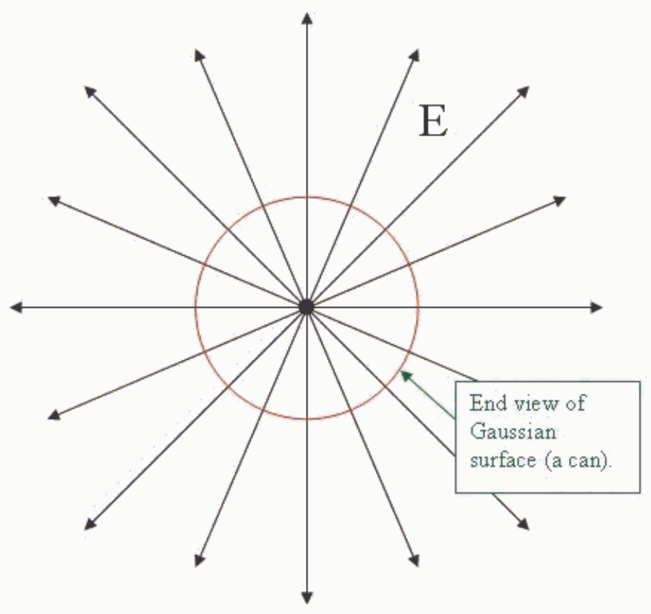

The pattern of the electric field has already been drawn to the extent that it can be established based on symmetry. Symmetry arguments can be used to establish the fact that the electric field is everywhere perpendicular to the line of charge, and, that the magnitude of the electric field is the same at all points that are one and the same distance from the line of charge. Thus the can is the ideal Gaussian surface. The integral

$$\oint \vec{E} \cdot d\vec{A}$$

can essentially be done by inspection. The fact that the choice of a can whose axis of symmetry is on the line of charge makes it so that the integral can be done by inspection is what makes the so-called "can" the ideal choice for the Gaussian surface for the uniform infinite linear charge distribution.
