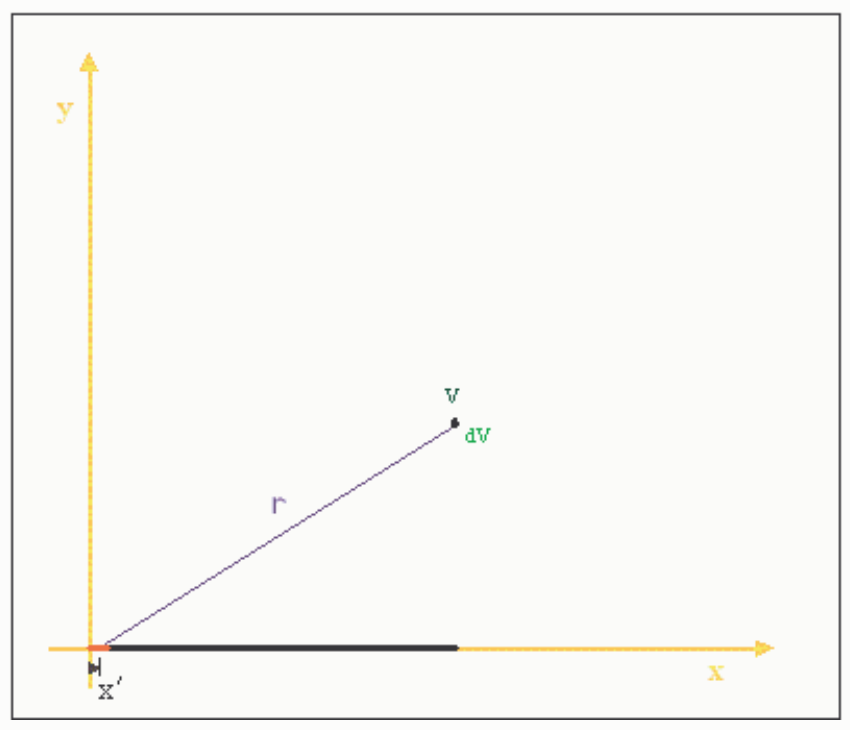

zone is to the motorist. "But officer, I left my house at noon and it's 1 pm now. I am now 40 miles from my house, so clearly my average speed is 40 mph," does not cut it with the officer and treating the average charge density as if it were the actual charge density does not cut it in physics.

The linear charge density is indeed a charge packing index, a value (with units of course) which indicates how closely packed the charges are.

## Question 4

## 0 of 20 points

Charge Q is uniformly distributed on a line segment that extends along the x-axis of a Cartesian coordinate system from the origin to $x=L$. (Hey, this is one of those situations in which the linear charge density is the same everywhere on the line segment, and the linear charge density is everywhere equal to the average charge density.) One is asked to find the electric potential valid for points on the positive y-axis. What should one use for the distance "r" that appears in the equation for $V$ below (copied directly from your formula sheet)?

$$V = \frac{kq}{r}$$

Selected Answer: ✗ $y$

Correct Answer: ✓ The $r$ varies with the infinitesimal element of charge under consideration. For each element of charge making up the charge distribution, the "r" is the distance from that element of charge to the point $(0,y)$.

Feedback: Let $x'$ be the distance that a particular infinitesimal charge element is from the origin. $x'$ is the variable of integration. $x'$ takes on values from 0 to $L$. For a given charge element on the x-axis the distance $r$ is $\sqrt{x'^2+y^2}$. Note that $r$ is a function of the variable of integration.

## Question 5

## 20 of 20 points

When one is calculating the electric potential at a particular point in space due to a continuous charge distribution, what exactly is one calculating?

Selected Answer: ✓ The electric-potential-energy-per-charge for the empty point in space in question.

Correct Answer: ✓ The electric-potential-energy-per-charge for the empty point in space in question.
