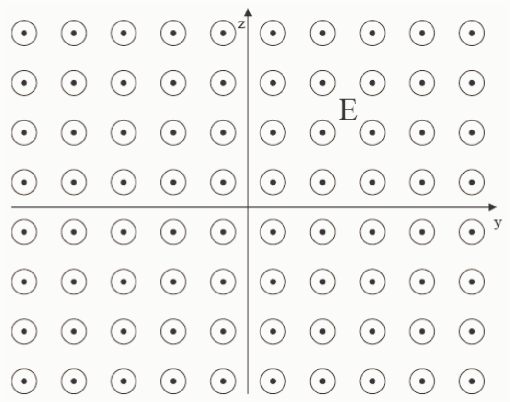

Draw the electric field diagram, as viewed by a person positioned on the positive x-axis who is looking back toward the origin for the case of an electric field characterized by the electric potential:

$$V = 5. 0 0 \frac {\text {volts}}{\text {meter}} x$$

Selected Answer: ✗

Correct Answer: ✓
