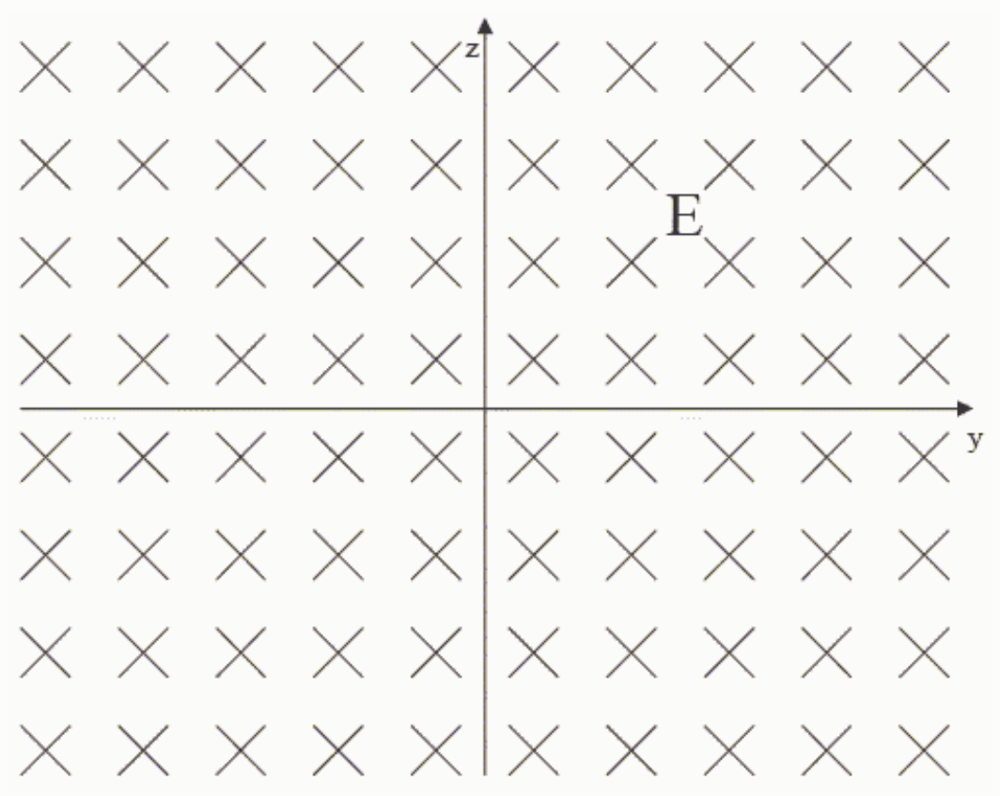

## Feedback:

\[
E _ {x} = - \frac {\partial V}{\partial x} \quad , \quad E _ {y} = - \frac {\partial V}{\partial y} \quad , \quad E _ {z} = - \frac {\partial V}{\partial z} \quad , \text {and} \quad \text {yield, for the given V,}
\]

$E_x = -5.00$ volts/meter,
$E_y = 0$, and,
$E_z = 0$.

So the electric field, everywhere, is in the negative x direction.
