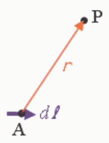

$$
d\vec{B} = \frac{\mu_o I \, d\vec{\ell} \times \vec{r}}{r^{3}}
$$

the direction of the magnetic field is in the direction of the cross product

$$
d\vec{\ell} \times \vec{r}
$$

A sketch will help us determine the direction of that cross product.

Note that the viewpoint for this sketch is "looking northward". So upward is toward the top of the screen. Northward is into the screen and southward is out of the screen.

Now we use the right-hand rule for the cross product of two vectors to determine the direction of the cross product.

We point the fingers of the right-hand rule in the direction of the first vector $d\vec{\ell}$. Then we rotate the hand about that direction (making sure that the fingers continue to point in the direction of $d\vec{\ell}$) until the hand is so oriented that if we close the fingers (just quickly for a test and then re-extend them) they point in the direction of the second vector, namely $\vec{r}$. We find that if the palm is facing upward (toward the top of the screen in the diagram) then the fingers do point in the direction of $\vec{r}$ when we close them (part way). With the hand thus oriented, the extended thumb points out of the screen, the direction in the diagram which we have identified as being **southward**.
