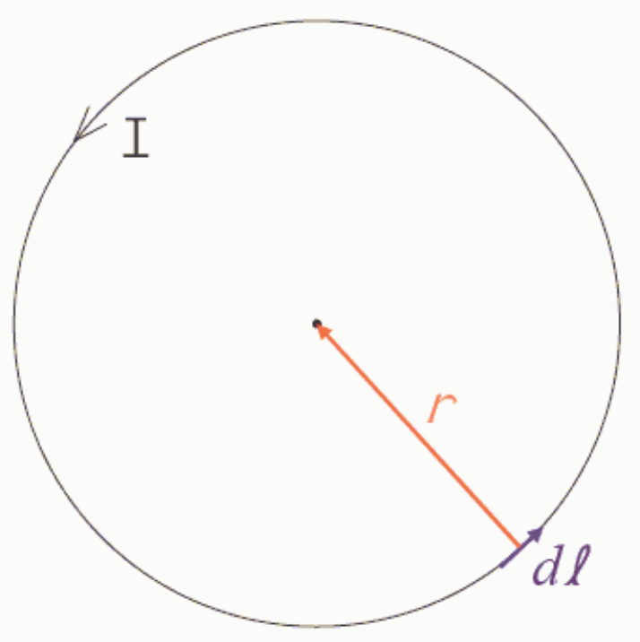

By the definition of what a circle is, every current element is the same distance from the center of the circle, namely the radius of the circle. Hence $r$ in this case is just the radius of the circle. Furthermore every $d\vec{\ell}$ is tangent to the circle while the vector $\vec{r}$ from the element in question to the center of the circle is along a radius. A radial vector is perpendicular to a tangential vector so the magnitude of $d\vec{\ell} \times \vec{r}$ is indeed $r\,d\ell$ for every $d\vec{\ell}$ on the circle.

Starting with the Biot-Savart Law:

$$d\vec{B} = \frac{\mu_o}{4\pi}\frac{I\,d\vec{\ell} \times \vec{r}}{r^3}$$

We have, for the magnitude of $dB$:

$$dB = \frac{\mu_o}{4\pi}\frac{I\,r\,d\ell}{r^3}$$

$$dB = \frac{\mu_o}{4\pi}\frac{I\,d\ell}{r^2}$$

$$\oint dB = \oint \frac{\mu_o}{4\pi}\frac{I\,d\ell}{r^2}$$

Because the $r$ is a constant we can pull it outside the integral yielding:

$$B = \frac{\mu_o}{4\pi}\frac{I}{r^2}\oint d\ell$$

The integral of $d\ell$ is, of course, just the circumference of the circle, so:

$$B = \frac{\mu_o}{4\pi}\frac{I}{r^2}2\pi r$$
