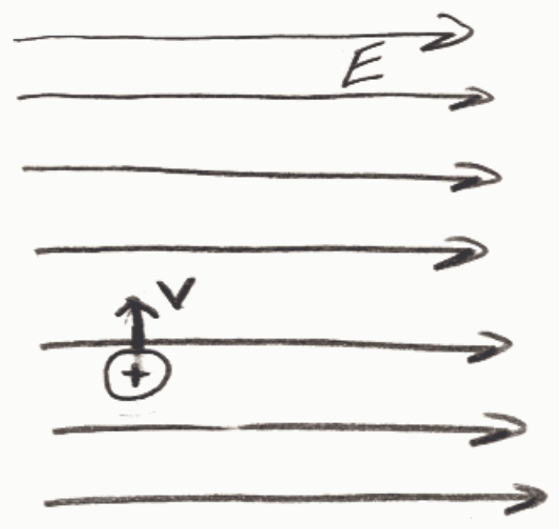

## Preview Assessment q02

Name: q02

Instructions:

Multiple Attempts: This Test allows multiple attempts.

Force Completion: This Test can be saved and resumed later.

## Question Completion Status:

## Question 1

## 20 points

Depicted below is a positively charged particle in a rightward-directed electric field. The particle has a velocity directed toward the top of the screen. What is the direction of the force, if any, exerted on the charged particle by the electric field?

○ Toward the top of the screen.

Rightward.

○ Toward the bottom of the screen.

○ Leftward.

○ Out of the screen. (Toward the viewer.)

Into the screen. (Away from the viewer.)

## Question 2

## 20 points

Depicted below is a positively charged particle in a uniform rightward-directed electric field. The particle has a velocity directed toward the top of the screen. Which of the paths depicted below right is the particle most likely to follow given that the force, if any, exerted on the particle by the electric field is the only force exerted on the particle.
