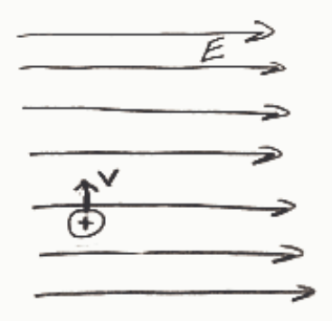
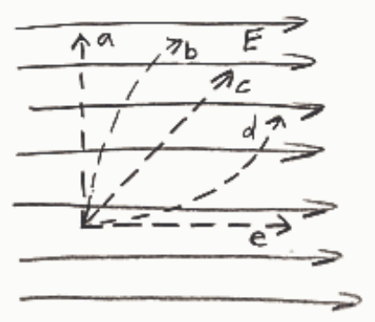

Path a

○ Path b

Path c

○ Path d

○ Path e

## Question 3

## 20 points

Is it possible for an electron to be moving northward in a northward-directed electric field?

☐ Only if there is a northward force exerted on the particle by some agent other than the electric field.

Yes, even if the force exerted on the electron by the electric field is the only force acting on the particle.

No.

## Question 4

## 20 points

Which of the following is not true of an electric field?

It has direction.

It cannot exist in vacuum.

It exists in the region around a charged particle or distribution of charged particles.

It is the association of a force-per-charge with points in space.

It will exert a force on any charged particle that is in the electric field.

○ It is invisible.

## Question 5

## 20 points

Why is it nonsense to say that an electric field attracts a charged particle?

Electric fields only repel charged particles. If the particle is positive the electric field repels it one way and if it is negative the electric field repels it the other way, but, the electric field always repels a charged particle.

It is not nonsense. That is exactly what an electric field does to any negatively charged particle.

It is not nonsense. That is exactly what an electric field does to any positively charged particle.

The electric field exerts a force on a charged particle that is in the electric field. But the word "attract" cannot be used to characterize that force. For an electric field to attract a charged particle the electric field would have to pull the charged particle toward itself. But the particle is "in" the electric field so there is no such direction as "toward the electric field." It would be like saying that air attracts a helium-filled balloon that is in the air or that
