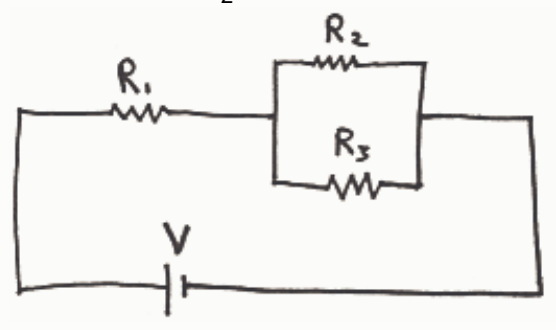

## Preview Assessment q11

Name: q11

Instructions:

Multiple Attempts: This Test allows multiple attempts.

Force Completion: This Test can be saved and resumed later.

## Question Completion Status:

## Question 1

## 20 points

Consider three resistors having three unique values of resistance. Suppose the resistors are connected in parallel with each other. Further suppose that the parallel combination of the three resistors is connected in a circuit such that at least some charge is flowing through each of the resistors. Which of the following statements is true? (Indicate all the correct answers.)

The current through each resistor is one and the same value.

The voltage across each resistor is one and the same value.

The effective resistance of the combination of resistors is greater than the resistance of any one of the individual resistors.

The effective resistance of the combination of resistors is less than the resistance of any one of the individual resistors.

## Question 2

## 20 points

Consider three resistors having three unique values of resistance. Suppose the resistors are connected in series with each other. Further suppose that the series combination of the three resistors is connected in a circuit such that at least some charge is flowing through each of the resistors. Which of the following statements is true? (Indicate all the correct answers.)

The current through each resistor is one and the same value.

The voltage across each resistor is one and the same value.

The effective resistance of the combination of resistors is greater than the resistance of any one of the individual resistors.

The effective resistance of the combination of resistors is less than the resistance of any one of the individual resistors.

## Question 3

## 20 points

For this circuit, which of the following represents a correct way of connecting an ammeter to measure the current through resistor  $R_{2}$ ? (Indicate all the correct answers.)

