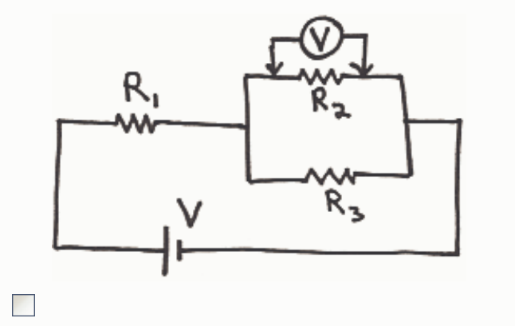
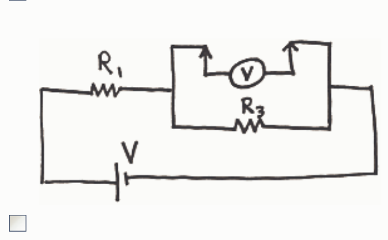
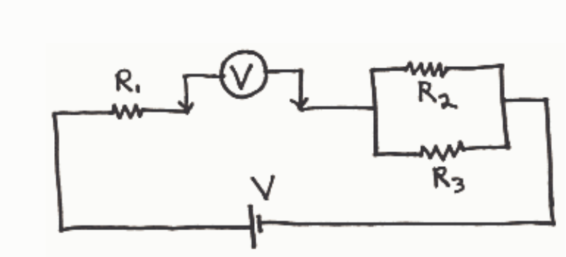

## Question 5

## 10 points

A circuit consists of a 10 volt battery connected in series with a 4 ohm resistor and a 6 ohm resistor. A person calculates the current through the 4 ohm resistor using Ohm's Law by dividing 10 volts by 4 ohms. What is wrong with this?

There is nothing wrong with it. That is exactly what one must do to get the current through the 4 ohm resistor.

In using Ohm's Law to determine the current through a resistor, one must use the resistance of the resistor and the voltage across the resistor. One cannot just use any voltage that happens to appear in the circuit. 10 volts is not the voltage across the resistor.

## Question 6

## 10 points

A circuit consists of a 10 volt battery connected in series with a 4 ohm resistor and a 6 ohm resistor. Why is it utter nonsense to say that 4 volts goes through the 4 ohm resistor? (Choose the one best answer.)

Because the resistors are in series, the whole ten volts goes through each resistor.

Voltage is potential difference. It doesn't ever go through anything. It doesn't "go" anywhere. It exists.

The smaller the resistor the more voltage goes through it. More than half of the ten volts has to go through the smaller resistor.

It is not utter nonsense. It is the truth.
