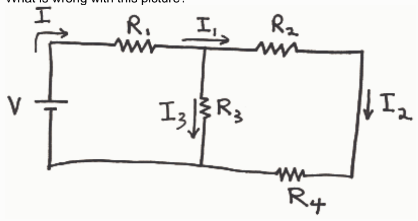

the calculation.

○ The positive sense for the current in question is established by means of an arrow pointing in that direction defined to be the positive direction for current. The negative sign in the result indicates that the current is actually in the direction opposite to that direction specified by the arrow.

○ The negative sign has no significance. Sometimes currents come out positive and sometimes they come out negative. The only thing that matters is the absolute value of the current.

○ None of the other answers is correct.

## Question 5

## 20 points

What is wrong with this picture?

○ $I$, $I_1$, and $I_2$ are all one and the same current.

○ $I$ and $I_1$ are one and the same current.

○ $I_1$ should be depicted a going rightward and then downward toward $R_3$ rather than going rightward and then continuing rightward toward $R_2$.

○ $I_1$ is depicted as going right through a junction. In actuality, where a current meets a junction (of three wires) part of the current goes one way and part of it goes another--it never just goes straight through the junction.
