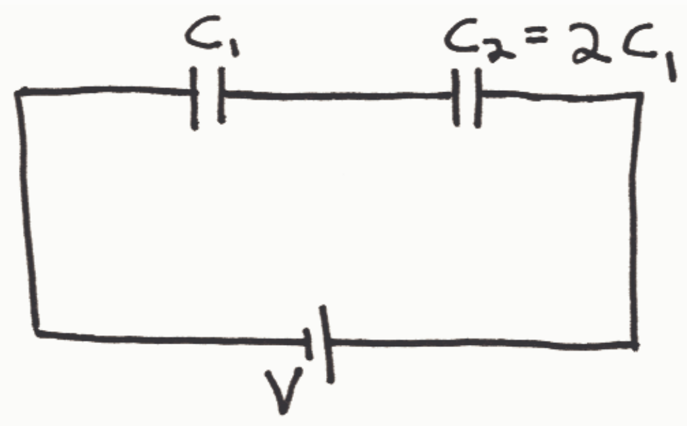
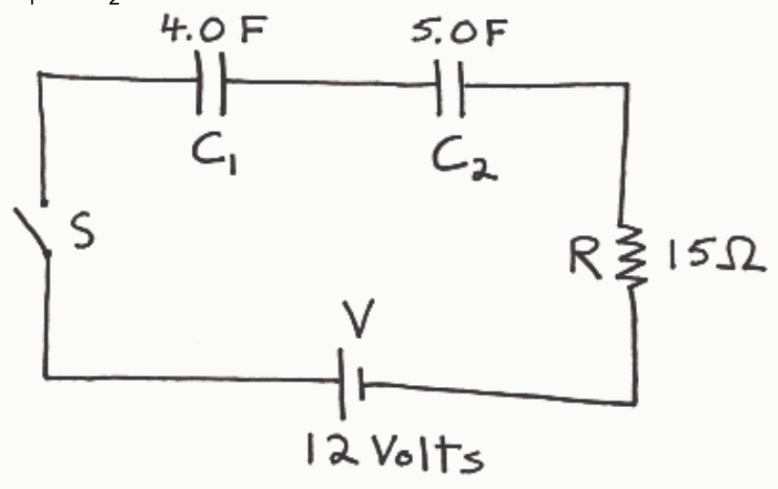

- Which capacitor has the greater charge?

- Which capacitor has the greater voltage?

A.  \( C_{1} \)

B.  \( C_{2} \)

C. Neither. They both have the same amount.

## Question 3

## 35 points

\( C_{1} \)  and  \( C_{2} \)  are initially uncharged.

- At the instant the switch is closed, what is the voltage across resistor R?

- At the instant the switch is closed, what is the current through resistor R?

- After the switch has been closed a very long time, so long that neither of the capacitors is still charging, what is the current through the resistor R?

- At the instant the switch is closed, what is the voltage across  \( C_{1} \) ?

A. 0 Volts

B. 5.3 Volts

C. 6.7 Volts

D. 12 Volts

E. 0 Amperes

F. 0.80 Amperes

G. 0 Coulombs

H. 27 Coulombs
