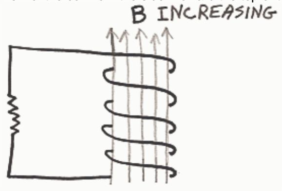

## Preview Assessment q18

Name: q18

Instructions:

Multiple Attempts: This Test allows multiple attempts.

Force Completion: This Test can be saved and resumed later.

## Question 1

## 30 points

Match the Name of the Law to the Law.

Lenz's Law

Ampere's Law

Faraday's Law of Induction

A. An electric current causes a magnetic field.

B. An electric current causes an electric field.

C. A changing number of magnetic field lines through a loop or coil induces a current to flow in that loop or coil.

D. A changing magnetic field causes an electric current.

E. The direction of the magnetic field caused by an electric current is opposite to the direction of the electric current.

F. The magnetic field produced by the current that is induced to flow in a loop or coil by a change in the number of magnetic field lines through that loop or coil is in that direction which tends to keep the number of magnetic field lines through the loop or coil at its original value in the original direction.

## Question 2

## 15 points

Indicate the direction of the current, if any, induced to flow in the coil by the changing magnetic field. (Depicted is a view of the coil from the side. Toward the top of the screen in the diagram, is upward.)

