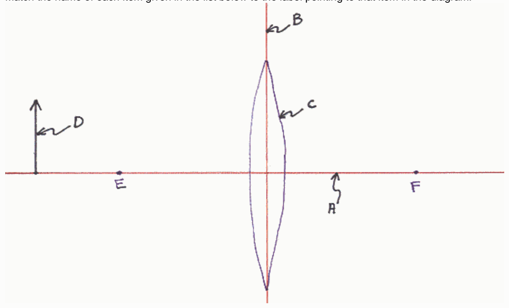

## Preview Assessment q28

Name: q28

Instructions:

Multiple Attempts: This Test allows multiple attempts.

Force Completion: This Test can be saved and resumed later.

## Question Completion Status:

## Question 1

## 9 points

Which of the following is a principal ray for the case of an actual physical object and a convex (converging) lens? Indicate all that apply.

A ray departing from the object along a line parallel to the principal axis of the lens, at the plane of the lens, adopts a path that takes it through the focal point on the other side of the lens.

A ray departing from the object along a line parallel to the principal axis of the lens, at the plane of the lens, adopts a path along the line that passes through the focal point on the same side of the lens as the object.

A ray departing from the object along a line that takes it through the center of the lens, at the plane of the lens, continues along that same path.

A ray departing from the object along a line that pass through the focal point on the other side of the lens, at the plane of the lens, adopts a path parallel to the principal axis of the lens.

A ray departing from the object along a line passing through the focal point on the same side of the lens as the object, at the plane of the lens, adopts a path parallel to the principal axis of the lens.

## Question 2

## 18 points

Match the name of each item given in the list below to the label pointing to that item in the diagram.

That focal point on the opposite side of the lens as the object.

A.
