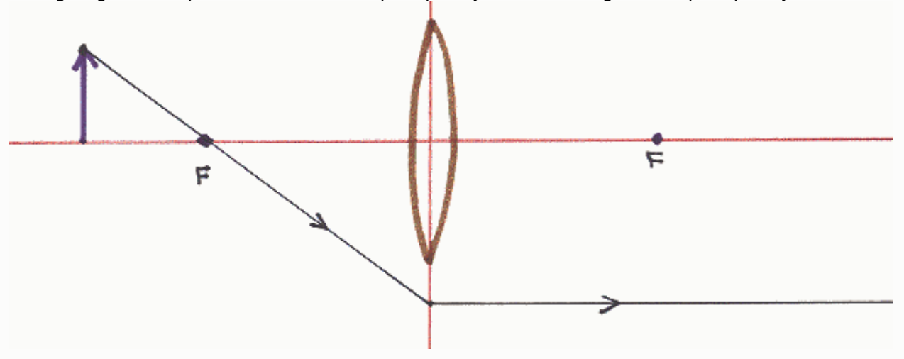

- That focal point on the same side of the lens as the object. B. C.

- The plane of the lens. D.

- The principal axis of the lens. E.

- An icon representing the lens. F.

- The object.

## Question 3

## 9 points

A person is attempting to determine the characteristics of an image formed by a converging lens by means of a ray tracing diagram. The person has drawn one principal ray. What is wrong with the principal ray?

Nothing.

It doesn't hit the lens.

There is no principal ray that goes through the focus on the same side of the lens as the object.

At the plane of the lens, the ray should adopt a straight path that takes it through the focal point on the other side of the lens.

○ No one of the other answers is correct.

## Question 4

## 9 points

A person is creating a ray tracing diagram to determine the characteristics of an image formed by a converging lens. So far, the person has gotten as far as drawing one of the principal rays. What is necessarily wrong with the ray tracing diagram so far?
