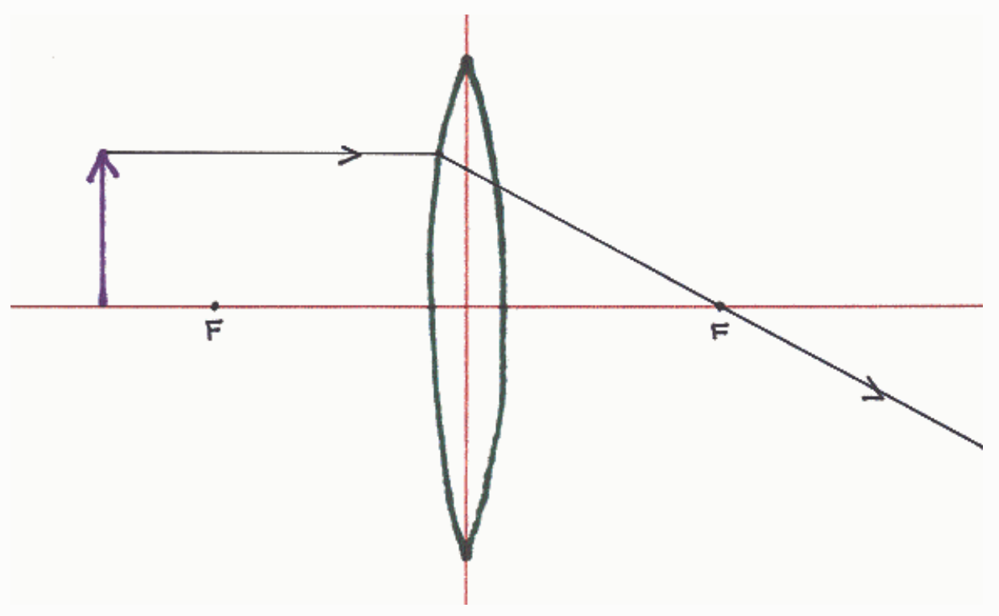
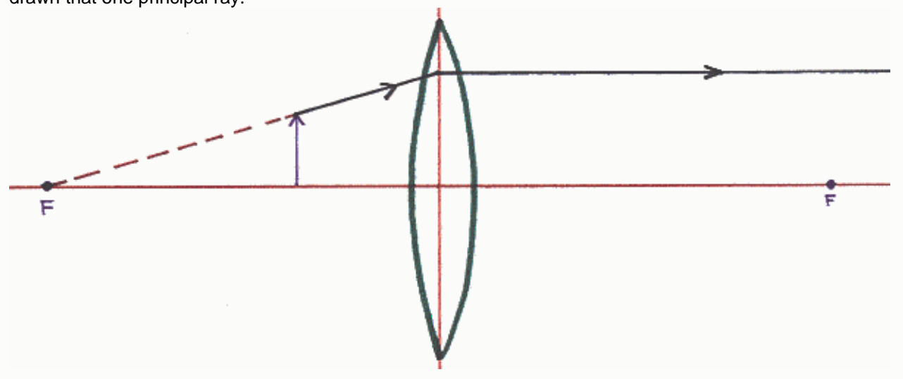

Nothing is necessarily wrong with the diagram so far.

Both focal points are depicted as being the same distance from the plane of the lens. This is never the case. One of the focal points has to be farther from the plane of the lens than the other.

The principle ray is depicted as changing its path at the surface of the lens. In the thin lens approximation central to thin lens ray tracing diagrams, the change of path is supposed to occur at the plane of the lens.

The principal ray depicted, on passing through the lens, is supposed to diverge from the principal axis of the lens. The person shows it converging toward the principal axis of the lens.

○ None of the other answers is correct.

## Question 5

## 9 points

A person is determining the characteristics of the image formed by a converging lens by means of a ray tracing diagram. The person has gotten as far as drawing one principal ray. What is wrong with the way the person has drawn that one principal ray.

Nothing.

The person has attempted to draw a principal ray collinear with a line passing through the focal point on the same side of the lens as the object. When the object is closer to the lens than the focal point, there is no such
