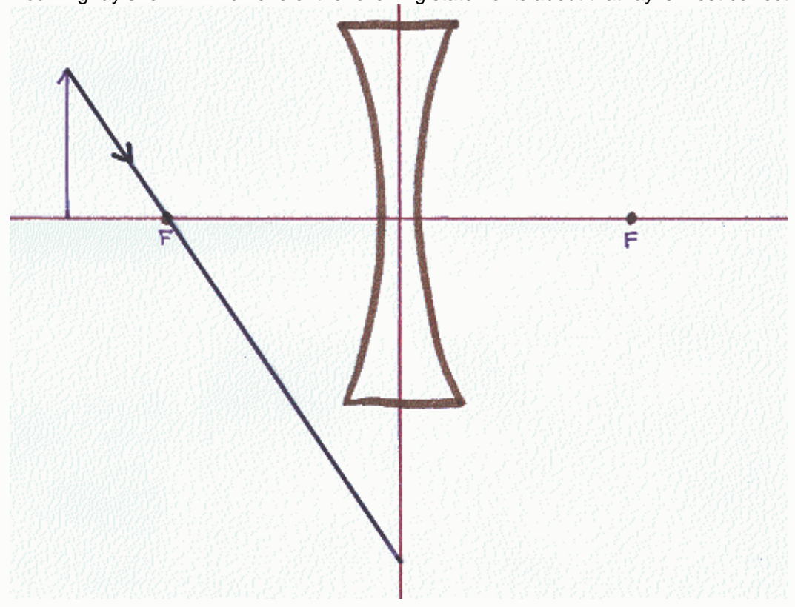

principal ray.

The principal ray the person is attempting to depict is supposed to go toward the focal point and then through it. The person has depicted the ray as being directed away from the focal point.

At the plane of the lens the ray should adopt a path which takes it through the focal point on the other side of the lens.

○ No one of the other answers is correct.

## Question 6

## 9 points

Which of the following is a principal ray for the case of an actual physical object and a concave (diverging) lens? Indicate all that apply.

A ray departing from the object along a line parallel to the principal axis of the lens, at the plane of the lens, adopts a path that takes it through the focal point on the other side of the lens.

A ray departing from the object along a line parallel to the principal axis of the lens, at the plane of the lens, adopts a path along the line that passes through the focal point on the same side of the lens as the object.

A ray departing from the object along a line that takes it through the center of the lens, at the plane of the lens, continues along that same path.

A ray departing from the object along a line that passes through the focal point on the other side of the lens, at the plane of the lens, adopts a path parallel to the principal axis of the lens.

A ray departing from the object along a line passing through the focal point on the same side of the lens as the object, at the plane of the lens, adopts a path parallel to the principal axis of the lens.

## Question 7

## 9 points

A person is tasked with creating a ray diagram to determine the characteristics of the image, of an object, formed by a concave lens. The person has correctly drawn the principal axis of the lens, the plane of the lens, the object, a lens icon to specify the kind of lens, and correctly drawn and labeled the focal points. Then the person draws the incoming ray shown. Which one of the following statements about that ray is most correct?

○ That ray is not a principal ray.

It is a principal ray, but, it misses the lens and is therefore of no use in determining the location of the image.

For purposes of determining the location of the image, the ray is to be drawn as if it continues as shown here:
