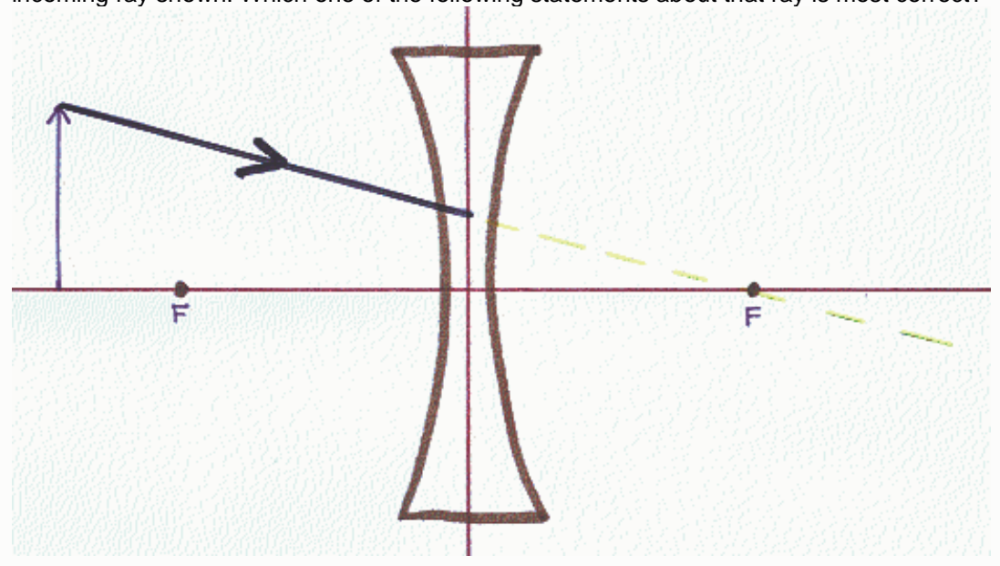
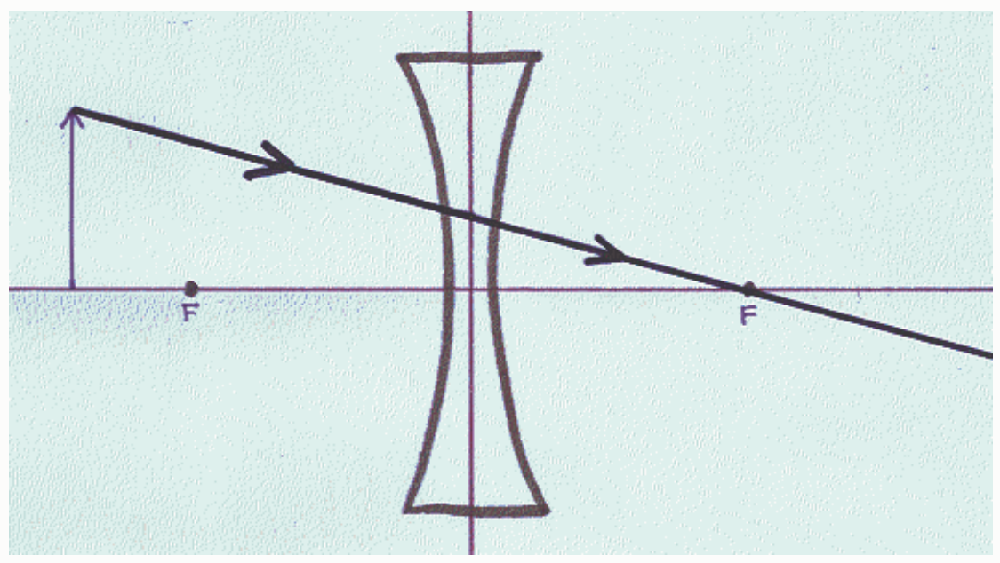

A person is tasked with creating a ray diagram to determine the characteristics of the image of an object formed by a concave lens. The person has correctly drawn the principal axis of the lens, the plane of the lens, the object, a lens icon to specify the kind of lens, and correctly drawn and labeled the focal points. Then the person draws the incoming ray shown. Which one of the following statements about that ray is most correct?

○ That ray is not a principal ray.

For purposes of determining the location of the image, the ray is to be drawn as if it continues as shown here:

For purposes of determining the location of the image, the ray is to be drawn as if it continues as shown here:
