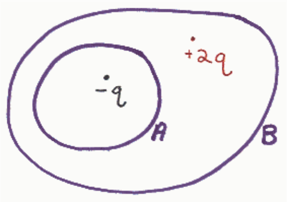

## Preview Assessment q32

Name: q32

Instructions:

Multiple Attempts: This Test allows multiple attempts.

Force Completion: This Test can be saved and resumed later.

## Question 1

## 20 points

In the diagram below, the closed curves A and B represent closed surfaces. What is the total flux through the closed surface A?

$$-\frac{q}{\varepsilon_o}$$

$$\frac{q}{\varepsilon_o}$$

$$\frac{2q}{\varepsilon_o}$$

0

## Question 2

## 20 points

In the diagram below the closed surfaces A and B appear as closed curves. Find the flux through closed surface B.
