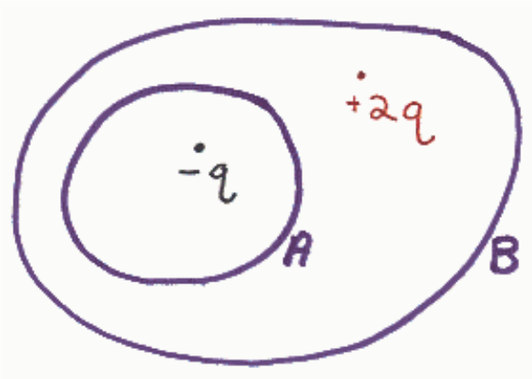

$$-\frac{q}{\varepsilon_o}$$

$$\frac{q}{\varepsilon_o}$$

$$\frac{2q}{\varepsilon_o}$$

0

## Question 3

## 20 points

Gauss's Law

$$\oint \vec{E} \cdot \vec{\text{dA}} = \frac{Q_{\text{IN}}}{\epsilon_o}$$

can be considered a "cause and effect" equation. When so considered, on which side of the equation is the "cause" and on which side is the "effect?"

The cause is on the left and the effect is on the right.

The cause is on the right and the effect is on the left.

## Question 4

## 20 points

Consider charge of uniform surface density (charge-per-area) everywhere on an infinite horizontal plane. In calculating the electric field due to such a charge distribution one can use a Gaussian surface in the shape of a tin can whose top is above and parallel to the plane in question and whose bottom is below and parallel to the plane. How can one tell that the electric flux through the walls of the can is zero? (If you remove the top of a can and the bottom of the can, that which is left, a piece that looks like a short length of pipe, is what we are calling the "walls" of the can.)

At any point on the walls of the can, due to symmetry, the electric field through one side of the can will be equal but opposite to the electric field through the other side of the can, thus the two contributions to the flux cancel each other out, yield a total flux of zero.

The can encloses no charge, hence the outward flux through the can must be zero.

Treating each area element of the can as a vector, the net area is zero, because, for every area element on one side of the can, there is an equal area element on the other side of the can with the exact opposite direction.
