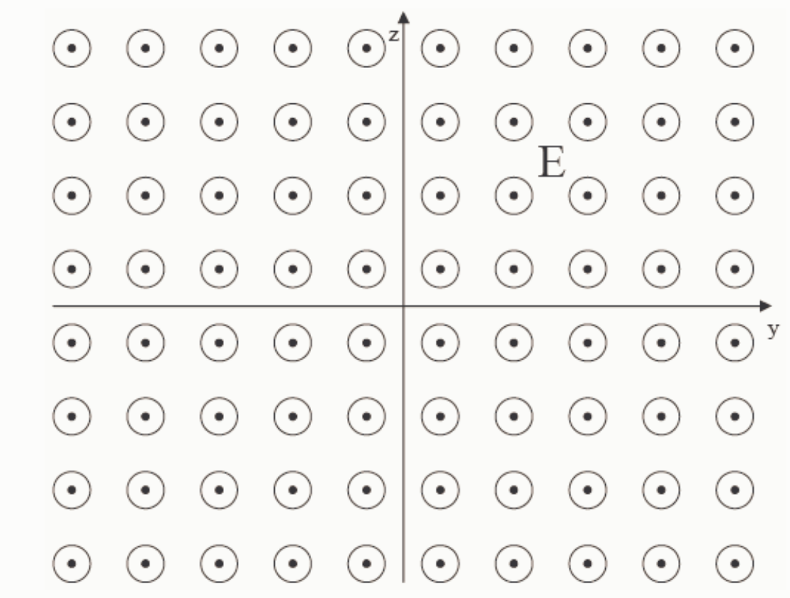

What does it mean to say that the electric potential is a function of x only. More specifically, what does the equipotential diagram (in 3-dimensional space) look like in the case of an electric potential that is a function of x only.

The equipotential diagram is a set of planes parallel to the y-z plane.

The equipotential diagram is a series of dots on the x axis.

The equipotential diagram is a series of spheres, all centered on the origin.

○ None of the above.

## Question 5

## 20 points

Draw the electric field diagram, as viewed by a person positioned on the positive x-axis who is looking back toward the origin for the case of an electric field characterized by the electric potential:

$$V = 5. 0 0 \frac {\text { volts }}{\text { meter }} x$$

