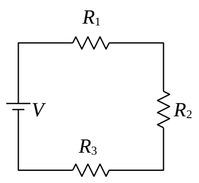
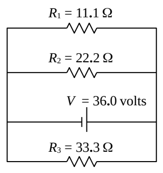
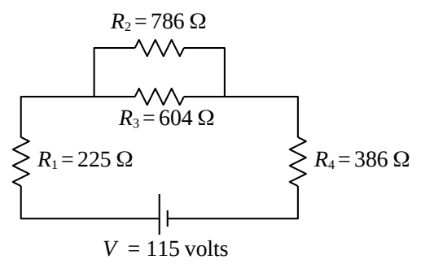

## SAC211

1) For the circuit at right, find the voltage across, and the current through, each of the resistors.

*Hints:*

- *In applying the method of combining resistors to form effective resistance (also known as the method of ever-simpler circuits), diagrams are a required part of the solution.*
- *In cases where values are not given, symbols provided in the given circuit diagram are to be considered as “givens” unless otherwise stated. In the final answers, each sought quantity is to be expressed in terms of “givens” (not in terms of quantities defined by and/or solved for by the problem solver).*

2) For the circuit at right, find the current through the seat of EMF.

3) For the circuit at right, find the current through $R_2$.

4) Two resistors have one and the same resistance $R$. If connected in series with each other they form a "single effective resistor" of resistance $R_{\text{S}}$. If connected in parallel with each other they form a "single effective resistor" of resistance $R_{\text{P}}$. Indicate all of the following that are true.

a) $R < R_{\text{P}}$

b) $R_{\text{P}} < R_{\text{S}}$

c) $R < R_{\text{S}}$

d) $R_{\text{P}} < R$

e) $R_{\text{S}} < R$

f) $R_{\text{S}} < R_{\text{P}}$

g) $R_{\text{P}} > R_{\text{S}}$

h) $R_{\text{S}} > R$
