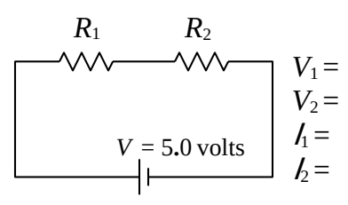
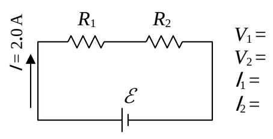
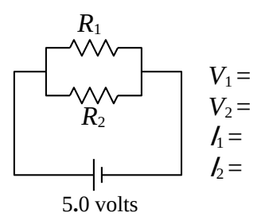
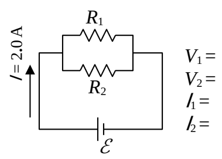

## SAC211 (Continued)

5) $V_1$ is the voltage across $R_1$

$V_2$ is the voltage across $R_2$

$I_1$ is the current through $R_1$

$I_2$ is the current through $R_2$

a) Beside each of the circuit diagrams that follow, write the value of each of the indicated quantities whose value can be determined by inspection (no calculation). Write nothing for any quantities whose value cannot be determined by inspection. Do not assume that there is at least one quantity whose value can be determined by inspection for each circuit. Mark each quantity determined by inspection with an asterisk.

b) Assuming $R_1 = 10.\ \Omega$ and $R_2 = 40.\ \Omega$ calculate those values which cannot be determined by inspection.

