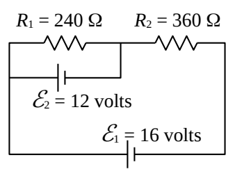
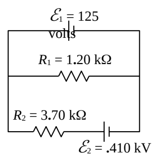
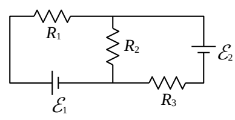
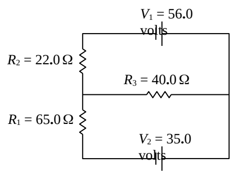
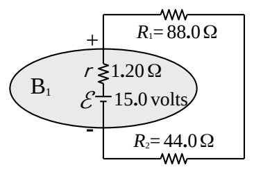
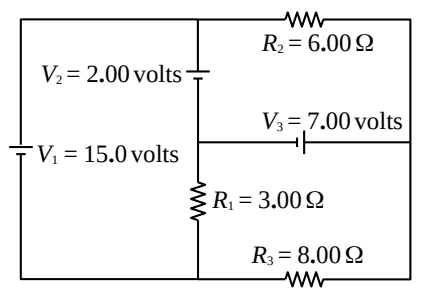

## SAC212

1-3) For each circuit, find the voltage across, and the current through, each resistor.

(1)

(2)

(3)

4) Find the current through, and the voltage across, each of the resistors in the circuit at right.

5) Find the terminal voltage for the battery B$_1$ in the circuit at right.

6) Find the current through, and the voltage across, each of the resistors in the circuit at right.

