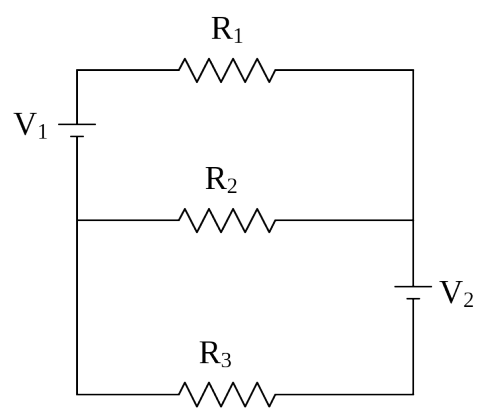

## SAC212 (Continued)

7) A real battery can be modeled by an ideal seat of EMF in series with a resistor known as the internal resistance of the battery. Both the seat of EMF and the internal resistance are inside the battery, in between the terminals. Suppose the ideal seat of EMF value is 9.00 volts and the internal resistance is 1.20 ohms.

a) What is the terminal voltage of the battery when it is not connected to anything?

b) What is the terminal voltage of the battery when it is connected across a 52.0 ohm resistor?

8) You are provided with a voltmeter, a battery, and a 222 ohm resistor. You measure the voltage across the battery when it is not connected to the resistor and find that voltage to be 6.20 volts. Then you measure the voltage across the battery while the battery is connected across the 222 ohm resistor and this time you find the voltage to be 5.80 volts.

a) Find the internal resistance of the battery.

b) Find the power dissipated by the internal resistor when the battery is connected across the 222 ohm resistor.

c) Find the value of a resistor which, when connected by itself across the battery, would cause the battery voltage to be 6.00 volts.

9) For the circuit at right:

a) Label the two terminals of each seat of EMF “+” or “–” as appropriate.

b) Draw arrows representing the currents in the various legs of the circuit. Label the arrows with symbols such as $I_2$ chosen to represent the currents.

c) Label the two terminals of each resistor “+” or “–” as appropriate.

d) Clearly indicate two loops in the circuit on which one can apply Kirchoff’s Loop Rule (a.k.a. Kirchoff’s Voltage Law) and write the equation for each loop.

e) Clearly indicate one junction at which one can apply Kirchoff’s Junction Rule (a.k.a. Kirchoff’s Current Law) and write the equation for that junction.

f) Solve for the voltage across, and the current through, each of the resistors. (Consider $V_1, V_2, R_1, R_2,$ and $R_3$ to be known.)

