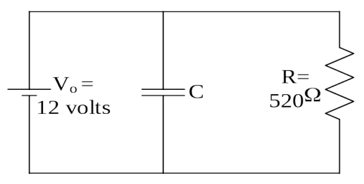

## SAC213

1) A 6.05 volt battery, a 157 kΩ resistor, and an initially-uncharged 472 μF capacitor are connected in series, with the final connection being made at time zero. How long does it take for the charge on the capacitor to reach 2.36 mC?

2) A 52.0 mF capacitor is connected across a 12.0 volt battery and left there until it stops charging. It is then disconnected from the battery and connected across a 37.0 ohm resistor with the final connection being made at time zero.

a) Find the initial current, the current when that final connection has just been made.

b) Find the current at time 3.00 seconds.

3) A capacitor is connected across a 15.0 volt battery and left there until it stops charging. Then the capacitor is disconnected from the battery and connected across a 32.0 MΩ resistor. It is observed that it takes 8.50 minutes for the voltage across the capacitor to drop down to 5.0 volts. Find the capacitance of the capacitor.

4) The resistor in the circuit at right represents a computer. The seat of EMF is a power supply for the computer. The capacitor, always fully charged when the power supply is working, serves as a temporary source of power in the event of a power failure. The computer normally operates at 12.0 volts, but it will continue to operate as long as the voltage is above 9.0 volts. What must the capacitance of the capacitor be if, the user of the computer is to have 4 minutes to save her work and properly shut down the computer in the

event of a power failure. Note that, upon power failure, the seat of EMF is to be considered disconnected from the circuit.

5) An initially uncharged 4.70 mF capacitor is connected in series with a 12.0 volt battery and a 222 kΩ resistor. How long does it take for the voltage across the capacitor to become 11.0 volts?

6) A 12 V battery, a 15 MΩ resistor, and a 5.6 nF capacitor are connected in series at time zero.

a) Find the initial current.

b) Find the current at time 0.10s.

c) Find the voltage across the capacitor at time 0.10 s.

d) Find the charge on the capacitor at time 0.10s.

d) Find the time when the current is one-half its initial value.

e) Find the maximum voltage across the capacitor.

f) When does this apply?

g) Find the maximum charge on the capacitor.

7) A 12 V battery, a 15 MΩ resistor, and a 5.6 nF capacitor are connected in series. After the capacitor is charged to the highest charge possible, the capacitor is removed from the circuit, and, at a new time zero, is connected across a second resistor. After 0.12 s, the voltage across the capacitor is observed to be 6.0 volts.

a) Find the resistance of the second resistor.

b) Find the current at t = 0.12 s.

c) At what time will the voltage be 3.0 volts?
