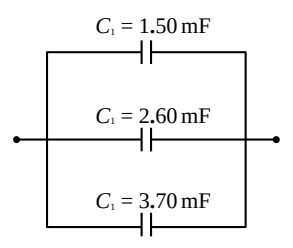
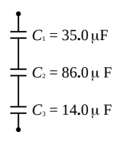
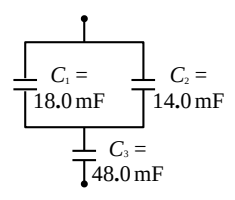
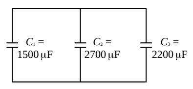
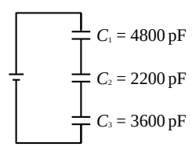
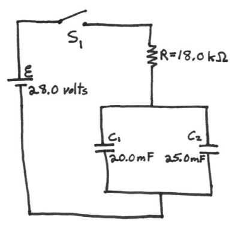

## SAC214

1) Find the effective capacitance of the combination of capacitors depicted at right.

2) Find the effective capacitance of the combination of capacitors depicted at right.

3) Find the effective capacitance of the combination of capacitors depicted at right.

4) Given that the voltage across  $C_{1}$  is 17.5 volts, find the voltage across, and the charge on, capacitors  $C_{2}$  and  $C_{3}$ . Consider the given values of capacitance to be good to three significant figures.

5) Given that the voltage across  $C_{1}$  is 5.00 volts, find the charge on, and the voltage across,  $C_{2}$  and  $C_{3}$ . Consider the given values of capacitance to be good to three significant figures.

6) Assuming both capacitors in the circuit at right to be initially uncharged, find the current through the resistor 78.0 s after switch  $S_{1}$  is closed.

