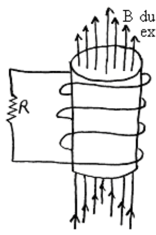

## SAC218

1) A horizontal ring of radius 0.280 cm is in a uniform downward-directed 3.68 mT magnetic field. Find the magnetic flux through the ring.

2) A horizontal triangle whose sides are of length 40.0 cm, 30.0 cm, and 20.0 cm respectively, is in a uniform upward-directed 0.500 T magnetic field. Find the magnetic flux through the triangle.

3) A horizontal square of side length 0.200 m is in an upward-directed magnetic field which is increasing at the rate of 5.00 mT/s. Find the rate of change of the magnetic flux through the loop.

4) At right is depicted a coil of wire through which upward-directed magnetic field lines due to an unspecified source, extend. Because of actions of an external agent (not specified) the magnetic field is decreasing. Which way (upward or downward) does the resulting current flow through the resistor. Explain thoroughly in a step-by-step fashion. Refer to each applicable law by name in your explanation.

B due to unshown external source.
