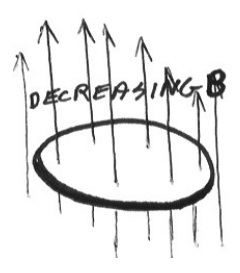
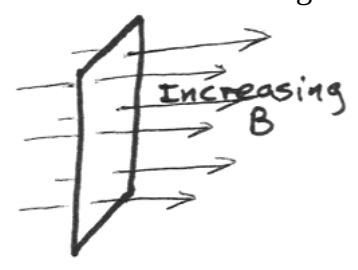
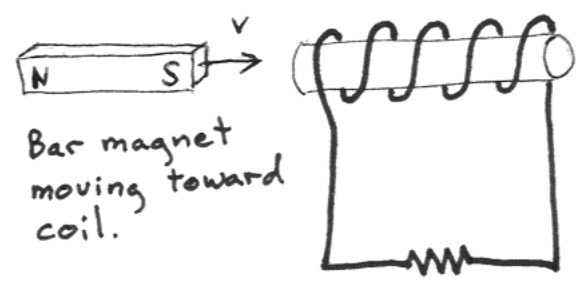
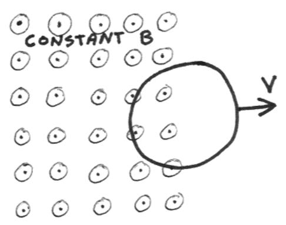
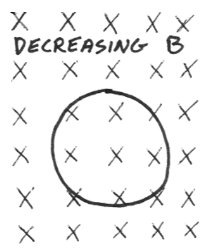
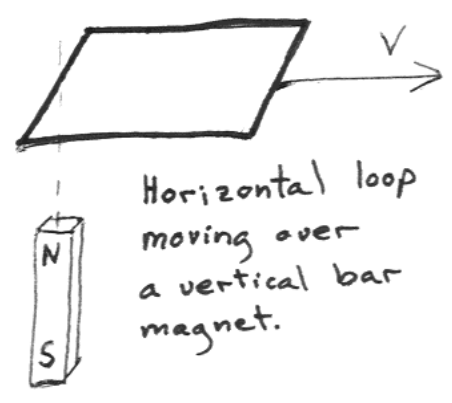

## SAC219

1) A horizontal loop of radius 0.180m is in a region of space where there is an upward directed magnetic field that is increasing in strength at the rate of 0.100T per second. The length of wire making up the loop has a resistance of 0.860mΩ. Find the current induced in the loop. State the direction of the current as well as the value with units.

2) In each diagram below, indicate, by means of an arrow (a curved arrow if appropriate) the direction of the current induced to flow in the loop or coil depicted. (If there is no induced current, write none at the bottom of the diagram.

3) A wire loop forms the perimeter of a flat circular area of $.36 \, m^{2}$. The resistance of the wire is 1.5 ohms. The loop lies in a horizontal plane in a region of space where there is a downward-directed magnetic field B = .015 tesla. The wire is pulled to one side so that it is completely out of the field after 0.20 s. For the 0.20 s period during which the loop is being pulled out of the magnetic field:

a) Find the average EMF in the loop.

b) Find the average current in the loop.

c) Find the total charge passing any point in the loop.

d) Find the average power dissipated in the loop.

e) Find the total energy dissipated in the loop.

f) Find the direction of the current in the loop.

4) The potential difference between the two terminals of an ordinary electrical receptacle in your home varies sinusoidally with a frequency of 60.0 Hz. The rms value of the oscillating voltage is between 115 volts and 120 volts. For a case in which the rms value is 117 volts, what is the amplitude of the oscillations of the voltage?
