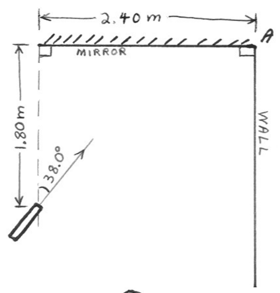
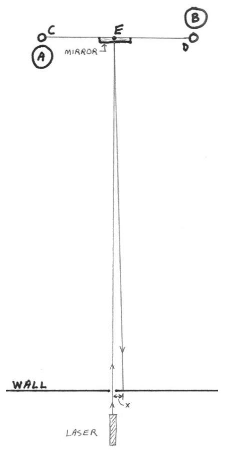

## SAC225

1) A laser shines a horizontal beam of light into a mirror as depicted at right. Where on the wall does the beam hit the wall. Specify your answer as a horizontal distance measured from corner A.

2) A Cavendish balance is used to determine the gravitational force exerted on one lead ball by another as depicted at right. The reader is looking down on the apparatus from above. The rod with the mirror and two small lead balls (C & D) is suspended by a thin gold ribbon at point E. Prior to the lead balls A & B being moved into the positions shown, the mirror was parallel to the wall opposite (that wall being 15.0 m from the mirror) and the incoming laser beam is perpendicular to both the wall and the mirror so that the laser beam reflects straight back on itself. Once lead balls A and B are moved into the positions shown, however, the rod with the mirror on it rotates through a tiny angle causing the beam to hit the wall a distance x = 3.20 mm from the point where the line along which the incoming beam travels, intersects the wall. Find the angle through which the rod rotates.

3) A ray of light is incident on a plane mirror at an angle of incidence of 15 degrees. What angle does the reflected ray make with the plane of the mirror? (Note that the angle of incidence is not measured with respect to the plane of the mirror.)
