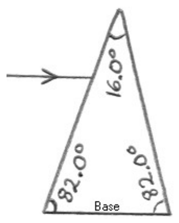

## SAC226

1) A ray of light traveling in air (index of refraction 1.00) toward a plane interface between the air and some glass whose index of refraction is 1.50 makes an angle of  $49.0^{\circ}$  with the surface of the glass. Find the angle of refraction.

2) A ray of light traveling in air, parallel to the base of a quartz (index of refraction 1.46) prism passes through the prism and comes out the other side. Find the angle that the exit ray makes with the base of the prism.

3) Starting with Snell's Law, find the critical angle for light traveling in water and encountering a water-to-air interface.
