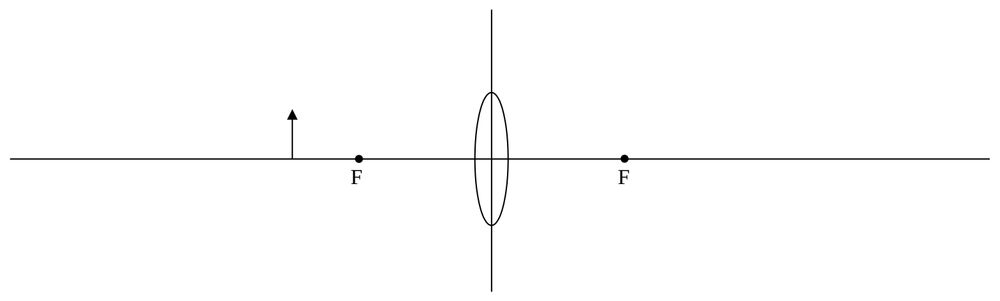

## SAC227

1) (You need a metric ruler for this one.) Construct a life-size (scale 1:1) ray-tracing diagram for the case of an 8.00 cm tall object that is 12.00 cm from a thin converging lens whose focal points are each 4.00 cm from the lens. Use the ray-tracing diagram (not calculations) to determine:
a) the position of the image,
b) the absolute value of the height of the image,
c) whether the image is erect or inverted, and,
d) whether the image is real or virtual.

Hint: In stating the position of the image, use the convention that the real physical object is in front of the lens and anything on the other side of the lens is behind the lens. Use a value-with-units and words to clearly state where the image is.

2) (You need a metric ruler for this one.) Construct a life-size (scale 1:1) ray-tracing diagram for the case of a 4.00 cm tall object that is 4.50 cm from a thin converging lens whose focal points are each 10.0 cm from the lens. Use the ray-tracing diagram (not calculations) to determine:
a) the position of the image,
b) the absolute value of the height of the image,
c) whether the image is erect or inverted, and,
d) whether the image is real or virtual.

Hint: In stating the position of the image, use the convention that the real physical object is in front of the lens and anything on the other side of the lens is behind the lens. Use a value-with-units and words to clearly state where the image is.

3) Use a ray diagram to locate the image of the arrow in the life-size (scale 1:1) diagram below. Show all three principle rays. Make measurements with a ruler to answer the questions.

a) At what distance “o” is the object from the lens? (The arrow appearing in the original diagram is the object. All distances “from a lens” are measured from the plane of the lens.)
b) What is the height of the object?
c) What is the image distance $i$?
d) What is the image height $h'$
e) What is the magnification?
f) Is the image real, or is it virtual?
g) Is the image erect, or is it inverted?
