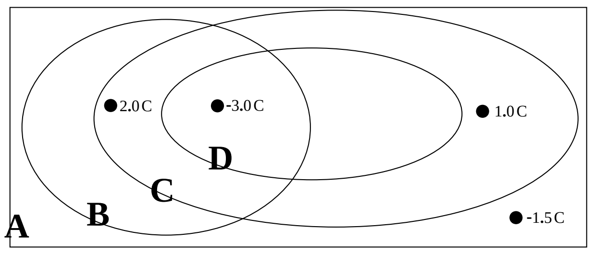

## SAC429

1) In the diagram below, each closed loop or rectangle (A, B, C, D) represents the intersection of an imaginary closed surface with the plane of the page. The black dots represent charged particles whose charges are indicated. (You have to use your imagination here. Consider the charged particles to lie in the plane of the page. The rectangle represents the intersection of an imaginary box with the plane of the page. Each oval represents the intersection of an imaginary spheroid with the plane of the page.) Find the electric flux through each of the closed surfaces.

2) Consider a rectangle whose corners are at: (-2.00 cm, 0, -4.10 cm), (0, +3.60 cm, -4.10 cm), (0, +3.60 cm, +4.10 cm), (-2.00 cm, 0, +4.10 cm). The rectangle is to be considered one side of a box which encloses the origin. Find the electric flux outward through the rectangle for the case of a uniform 1460 N/C electric field that is:

a) in the +x direction.

b) in the +y direction.

c) in the +z direction.

3) Consider a flat circular sheet of radius 3.60 cm whose center is at (4.00 cm, 6.00 cm, 5.00 cm) which is facing away from the origin (the outward direction is away from the origin) in the same direction as the position vector of its center. Find the electric flux outward through the flat circular sheet for the case of a uniform 2250 N/C electric field that is:

a) in the +x direction.

b) in the +y direction.

c) in the +z direction.
