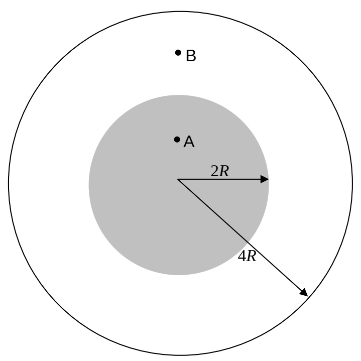

## SAC430

1) Charge Q is distributed uniformly throughout the volume of the inner sphere of radius 2R at right. Charge -Q/2 is distributed uniformly on the spherical shell of radius 4R at right. The two spheres are centered on one and the same point. Use Gauss's Law to find the electric field at points A, B, and C, at distances R, 3R, and 5R respectively from the center of the charge distribution.

2) You are asked to cover a smooth sphere of radius 3.00 m with contact paper. There is to be no overlap. You are provided with a stack of sheets of contact paper each in the shape of a square, 1.00 meters on a side. You are free to cut the contact paper any way you please. How many sheets of contact paper will you need. Give your answer to the nearest 1/100 of a sheet.

3) A point charge of  $-6.25 \times 10^{-7} C$  is at the common center of a spherical shell of radius 1.50 m and another spherical shell of radius 4.00 m.  $+1.00 \times 10^{-6} C$  of charge is uniformly distributed on the smaller shell and  $+2.00 \times 10^{-6} C$  of charge is uniformly distributed on the larger shell. Find the electric field at a point 3.00 m away from the point charge. Include an appropriate sketch as part of your answer.
