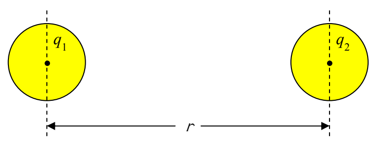

$$F = k \frac{|q_1| |q_2|}{r^2} \tag{1-1}$$

where:

$k = 8.99 \times 10^{9} \frac{\text{N} \cdot \text{m}^{2}}{\text{C}^{2}}$, a universal constant called the Coulomb constant,

$q_1$ is the charge of particle 1,

$q_2$ is the charge of particle 2, and

$r$ is the distance between the two particles.

The user of the equation (we are still talking about equation 1-1, $F = k \frac{|q_1| |q_2|}{r^2}$) is expected to establish the direction of the force by means of “common sense” (the user’s understanding of what it means for like charges to repel and unlike charges to attract each other).

While Coulomb’s Law in equation form is designed to be exact for point particles, it is also exact for spherically symmetric charge distributions (such as uniform balls of charge) as long as one uses the center-to-center distance for $r$.

Coulomb’s Law is also a good approximation in the case of objects on which the charge is not spherically symmetric as long as the objects’ dimensions are small compared to the separation of the objects (the truer this is, the better the approximation). Again, one uses the separation of the centers of the charge distributions in the Coulomb’s Law equation.

Coulomb’s Law can be written in vector form as:

$$\vec{\mathbf{F}}_{12} = k \frac{q_1 q_2}{r^2} \hat{\mathbf{r}}_{12} \tag{1-2}$$

where:

$\vec{\mathbf{F}}_{12}$ is the force “of 1 on 2”, that is, the force exerted by particle 1 on particle 2,

$\hat{\mathbf{r}}_{12}$ is a unit vector in the direction “from 1 to 2”, and

$k$, $q_1$, and $q_2$ are defined as before (the Coulomb constant, the charge on particle 1, and the charge on particle 2 respectively).
