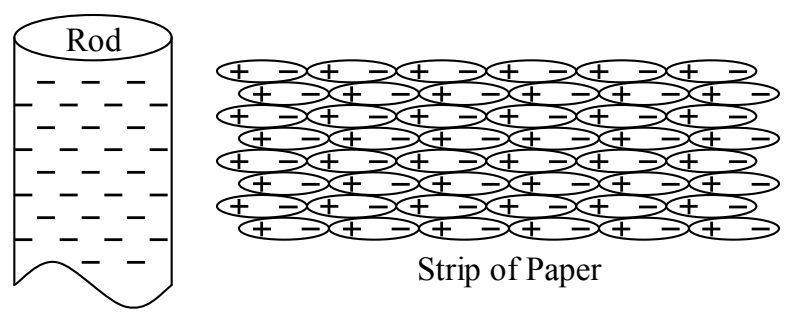

If you hold one side of a conductor in contact with ground and bring a charged object very near the other side of the conductor, and then, keeping the charged object close to the conductor without touching it, break the contact of the conductor with ground, you will find that the conductor is charged with the opposite kind of the charge that was originally on the charged object. Here's why. When you bring the charged object near the conductor, it repels charge in the conductor right out of the conductor and into the earth. Then, with those charges gone, if you break the path to ground, the conductor is stuck with the absence of those charged particles that were repelled into the ground. Since the original charged object repels the same kind of charge that it has, the conductor is left with the opposite kind of charge.

## Polarization

Let's rub that rubber rod with fur again and bring the rubber rod near one end of a small strip of neutral aluminum foil. We find that the foil is attracted to the rubber rod, even though the foil remains neutral. Here's why:

The negatively charged rubber rod repels the free-to-move negative charge in the strip to the other end of the strip. As a result, the near end of the aluminum strip is positively charged and the far end is negatively charged. So, the rubber rod attracts the near end of the rod and repels the far end. But, because the near end is nearer, the force of attraction is greater than the force of repulsion and the net force is toward the rod. The separation of charge that occurs in the neutral strip of aluminum is called polarization, and, when the neutral aluminum strip is positive on one end and negative on the other, we say that it is polarized.

Polarization takes place in the case of insulators as well, despite the fact that charge is not free to move about within an insulator. Let's bring a negatively-charged rod near one end of a piece of paper. Every molecule in the paper has a positive part and a negative part. The positive part is attracted to the rod and the negative part is repelled. The effect is that each molecule in the paper is polarized and stretched. Now, if every bit of positive charge gets pulled just a little bit closer to the rod and every bit of negative charge gets pushed a little farther away, the net effect in the bulk of the paper is to leave it neutral, but, at the ends there is a net charge. On the near end, the repelled negative charge leaves the attracted positive charge all by itself, and, on the far end, the attracted positive charge leaves the repelled negative charge all by itself.

As in the case of the aluminum strip, the negative rubber rod attracts the near, positive, end and repels the far, negative, end, but, the near end is closer so the attractive force is greater, meaning that the net force on the strip of paper is attractive. Again, the separation of the charge in the paper is called polarization and the fact that one end of the neutral strip of paper is negative and the other is positive means that the strip of paper is polarized.
