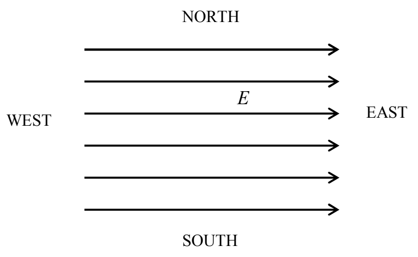

the same diagram. The closer the lines are, the stronger the electric field they represent. In the case of the uniform electric field in question, because the magnitude of the electric field is the same everywhere (which is what we mean by “uniform”), the line spacing must be the same everywhere. Furthermore, because the electric field in this example has a single direction, namely eastward, the electric field lines will be straight lines, with arrowheads:

