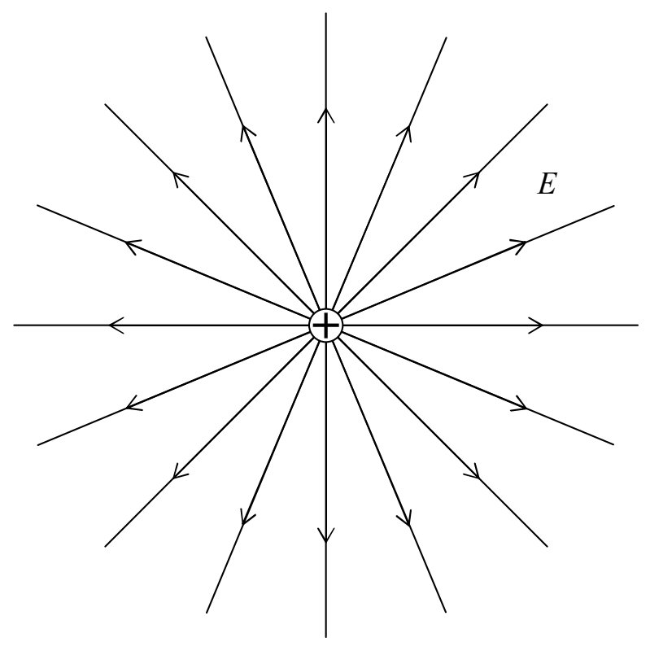

around the source charge, you put the positive test charge. So, put your imaginary positive test charge back in your pocket. It has done its job. We know what we needed to know. The electric field due to a positive source charge, at any point in the region of space around that positive source charge, is directed directly away from the positive source charge. At every point in space, around the positive source charge, we have an electric field vector (a force-per-charge-of-would-be-victim vector) pointing directly away from the positive source charge. So, how do we draw the electric field diagram for that? We are supposed to draw a set of lines or curves with arrowheads (NEVER OMIT THE ARROWHEADS!), such that, at every point on each line or curve, the electric field vector at that point is directed along the line or curve in the direction specified by the arrowhead or arrowheads on that line or curve. Let's give it a try.

The number of lines drawn extending out of the positive source charge is chosen arbitrarily, but, if there was another positively charged particle, with twice the charge of the first one, in the same diagram, I would need to have twice as many lines extending out of it. That is to say that the line spacing has no absolute meaning overall, but it does have some relative meaning within a single electric field diagram. Recall the convention that the closer together the electric field lines are, the stronger the electric field. Note that in the case of a field diagram for a single source charge, the lines turn out to be closer together near the charged particle than they are farther away. It turned out this way when we created the diagram to be consistent with the fact that the electric field is always directed directly away from the source charge. The bunching of the lines close to the source charge (signifying that the electric field is strong there) is consistent with the inverse square dependence of the electric field magnitude on the distance of the point of interest from the source charge.

There are a few of important points to be made here. The first one is probably pretty obvious to you, but, just to make sure: The electric field exists between the electric field lines—its
