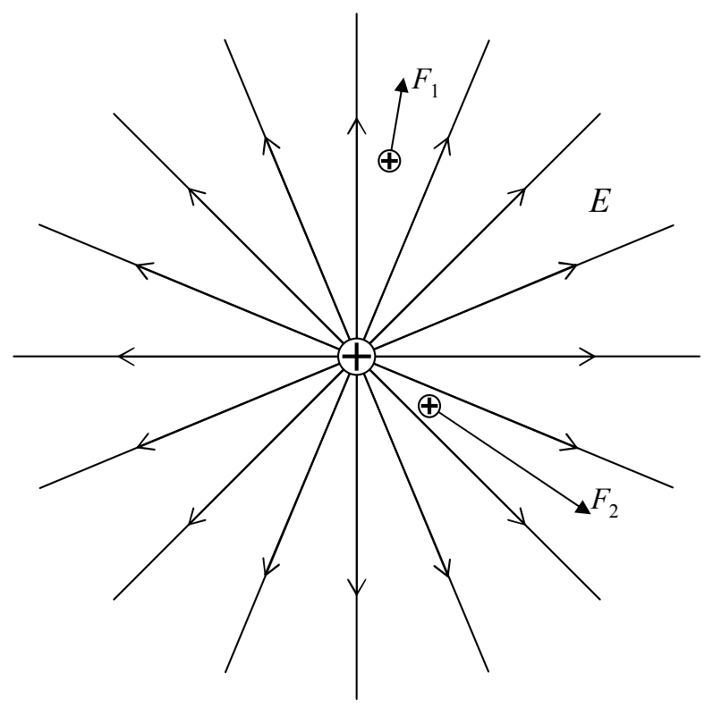
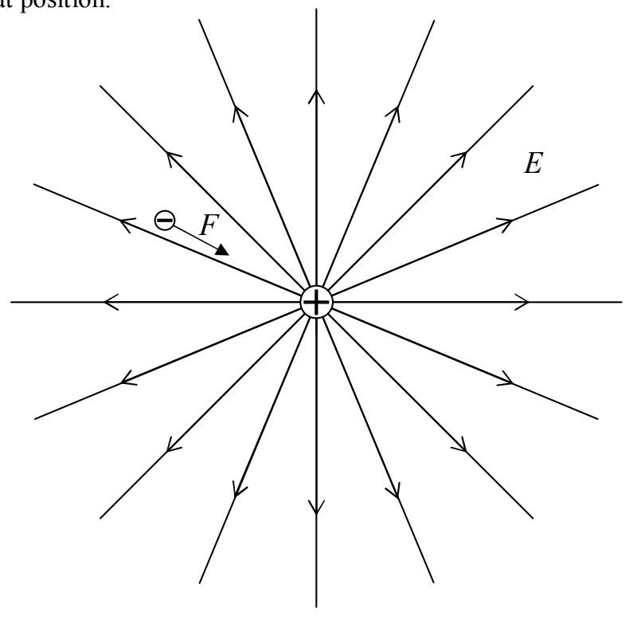

existence there is implied by the lines that are drawn—we simply can’t draw lines everywhere that the electric field does exist without completely blackening every square inch of the diagram. Thus, a charged victim that finds itself at a position in between the lines will experience a force as depicted below for each of two different positively-charged victims.

The next point is a reminder that a negatively-charged particle that finds itself at a position at which an electric field exists, experiences a force in the direction exactly opposite that of the electric field at that position.

