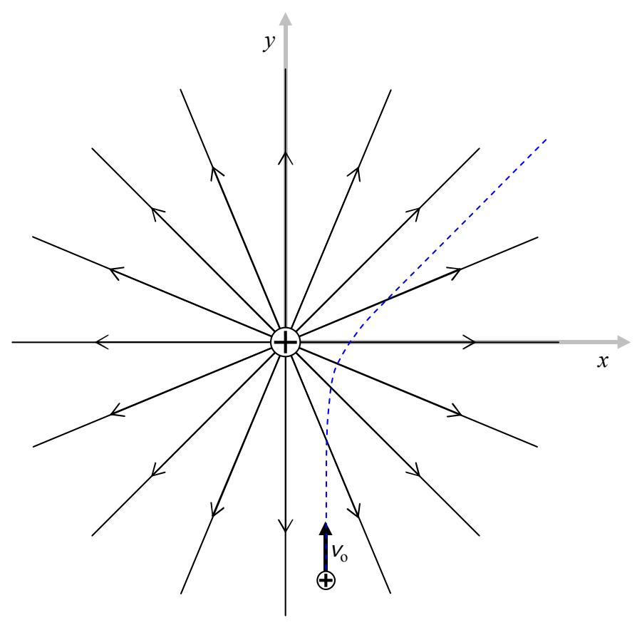

The third and final point that should be made here is a reminder that the direction of the force experienced by a particle, is not, in general, the direction in which the particle moves. To be sure, the expression “in general” implies that there are special circumstances in which the particle would move in the same direction as that of the electric field but these are indeed special. For a particle on which the force of the electric field is the only force acting, there is no way it will stay on one and the same electric field line (drawn or implied) unless that electric field line is straight (as in the case of the electric field due to a single particle). Even in the case of straight field lines, the only way a particle will stay on one and the same electric field line is if the particle’s initial velocity is zero, or if the particle’s initial velocity is in the exact same direction as that of the straight electric field line. The following diagram depicts a positively-charged particle, with an initial velocity directed in the +y direction. The dashed line depicts the trajectory for the particle (for one set of initial velocity, charge, and mass values). The source charge at the origin is fixed in position by forces not specified.

