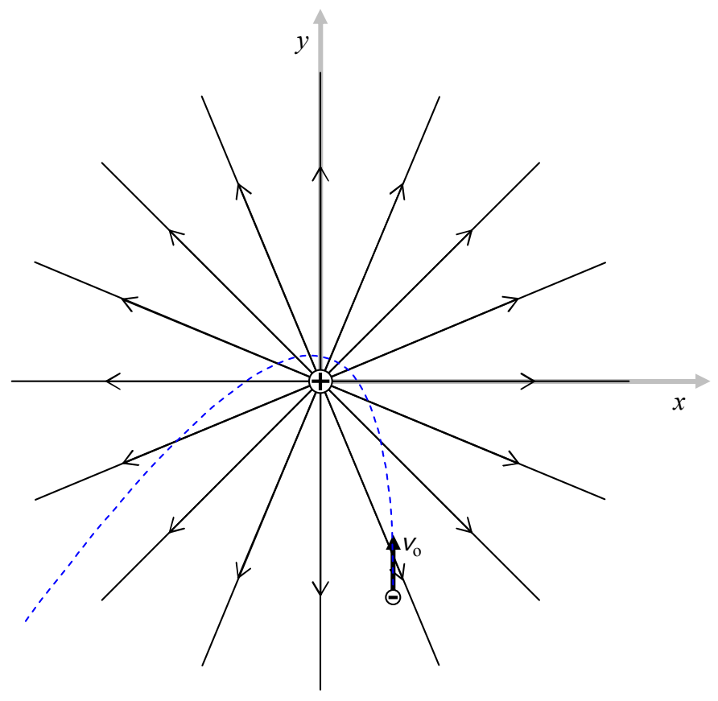

Here is an example of a trajectory of a negatively-charged particle, again for one set of values of source charge, victim charge, victim mass, and victim initial velocity:

Again, the point here is that, in general, charged particles do not move along the electric field lines, rather, they experience a force along (or, in the case of negative particles, in the exact opposite direction to) the electric field lines.

At this point, you should know enough about electric field diagrams to construct the electric field diagram due to a single negatively-charged particle. Please do so and then compare your work with the following diagram:
