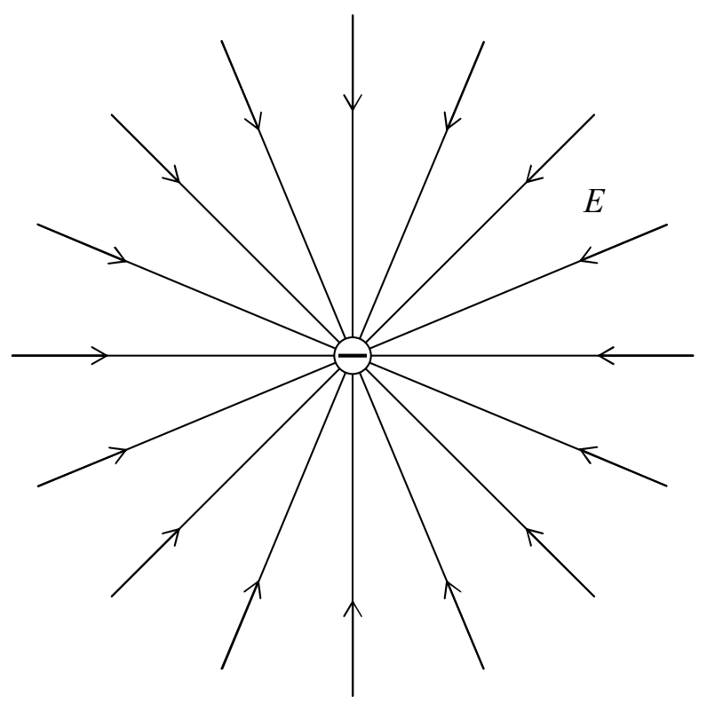

## Some General Statements that can be made about Electric Field Lines

The following useful facts about electric field lines can be deduced from the definitions you have already been provided:

1) Every electric field line begins either at infinity or at a positive source charge.

2) Every electric field line ends either at infinity or at a negative source charge.

3) Electric field lines never cross each other or themselves.

## Superposition

If there is more than one source charge, each source charge contributes to the electric field at every point in the vicinity of the source charges. The electric field at a point in space in the vicinity of the source charges is the vector sum of the electric field at that point due to each source charge. For instance, suppose the set of source charges consists of two charged particles. The electric field at some point P will be the electric field vector at point P due to the first charged particle plus the electric field vector at point P due to the second particle. The determination of the total electric field at point P is a vector addition problem because the two electric field vectors contributing to it are, as the name implies, vectors.
