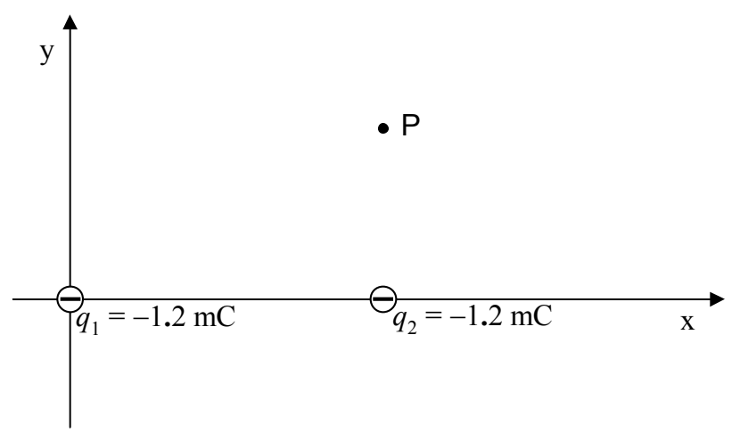
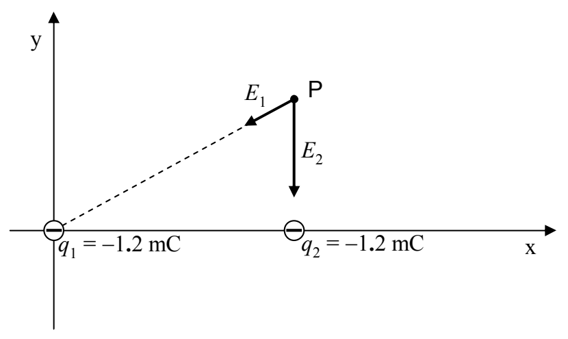

Suppose, for instance, that you were asked to find the magnitude and direction of the electric field vector$^2$ at point $P$ due to the two charges depicted in the diagram below:

given that charge $q_1$ is at $(0,0)$, $q_2$ is at $(11\text{ cm}, 0)$ and point $P$ is at $(11\text{ cm}, 6.0\text{ cm})$. The first thing that you would have to do is to find the direction and magnitude of $\vec{E}_1$ (the electric field vector due to $q_1$) and the direction and magnitude of $\vec{E}_2$ (the electric field vector due to $q_2$).

Referring to the diagram above, the direction of $\vec{E}_2$ is “the $-y$ direction” by inspection.

$^2$ We use the expression “the electric field vector at point $P$” for added clarity in distinguishing between the electric field as the infinite set of all electric field vectors and the electric field as the electric field vector at a particular point in space. The reader is warned that it is common practice to use the expression “the electric field at point $P$” and the reader is expected to tell from the context, that it means “the electric field vector at point $P$”.
