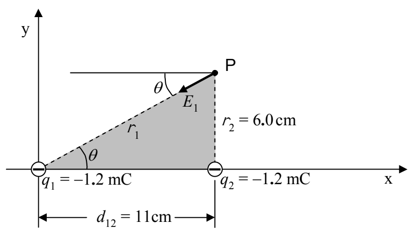

The angle  $\theta$  specifying the direction of  $\vec{E}_{1}$  can be determined by analyzing the shaded triangle in the following diagram.

Analysis of the shaded triangle will also give the distance  $r_{1}$  that point P is from charge  $q_{1}$ . The value of  $r_{1}$  can then be substituted into

$$E _ {1} = \frac {k \left| q _ {1} \right|}{r _ {1} ^ {2}}$$

to get the magnitude of  $\vec{E}_{1}$ . Based on the given coordinates, the value of  $r_{2}$  is apparent by inspection and we can use it in

$$E _ {2} = \frac {k \left| q _ {2} \right|}{r _ {2} ^ {2}}$$

to get the magnitude of  $\vec{E}_{2}$ . With the magnitude and direction for both  $\vec{E}_{1}$  and  $\vec{E}_{2}$ , you follow the vector addition recipe to arrive at your answer:

## The Vector Addition Recipe

1. For each vector:

a. Draw a vector component diagram.

b. Analyze the vector component diagram to get the components of the vector.

2. Add the x components to get the x component of the resultant.

3. Add the y components to get the y component of the resultant.

4. For the resultant:

a. Draw a vector component diagram.

b. Analyze the vector component diagram to get the magnitude and direction of the resultant.
