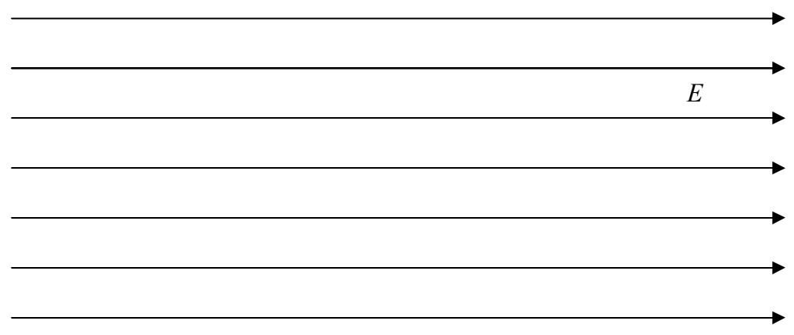
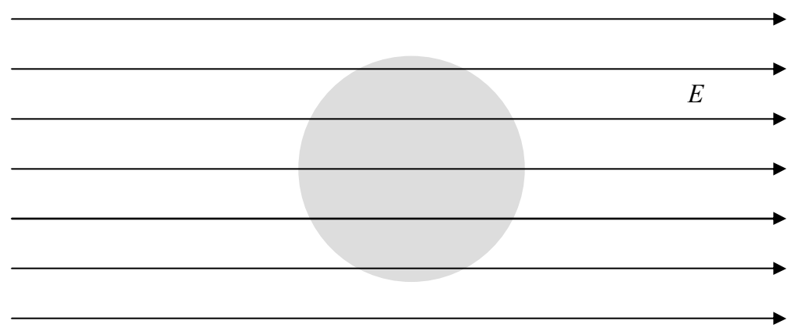

5) How would your answers to questions 1-4 change if the conductor had some shape other than spherical?

Here we provide the answers (preceded in each case, with the corresponding question).

1) Suppose you put a neutral ideal conducting solid sphere in a region of space in which there is, initially, a uniform electric field. Describe (as specifically as possible) the electric field inside the conductor and the electric field at the surface of the conductor. Describe the distribution of charge in and on the conductor.

Answer: We start with a uniform electric field.

We put a solid, ideal conductor in it. The electric field permeates everything, including the conductor.

The charged particles in the conductor respond to the force exerted on them by the electric field. (The force causes acceleration, the acceleration of particles that are initially at rest causes them to acquire some velocity. In short, they move.) All this occurs in less than a microsecond. The net effect is a redistribution of the charged particles.
