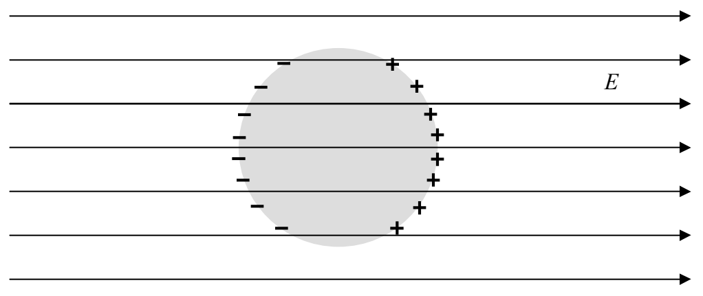
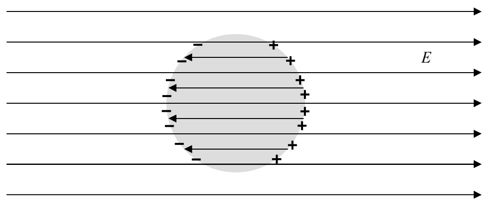

Now, get this! The charged particles create their own electric field.

The total electric field at any point in the conductor is the vector sum of the original electric field and the electric field due to the redistributed charged particles. Since they are oppositely-directed, the two contributions to the electric field inside the conductor tend to cancel each other. Now comes the profound part of the argument: the two contributions to the electric field at any point in the conductor exactly cancel. We know they have to completely cancel because, if they didn't, the free-to-move-charge in the conductor would move as a result of the force exerted on it by the electric field. And the force on the charge is always in a direction that causes the charge to be redistributed to positions in which it will create its own electric field that tends to cancel the electric field that caused the charge to move. The point is that the charge will not stop responding to the electric field until the net electric field at every point in the conductor is zero.

So far, in answer to the question, we have: The electric field is zero at all points inside the conductor, and, while the total charge is still zero, the charge has been redistributed as in the following diagram:
