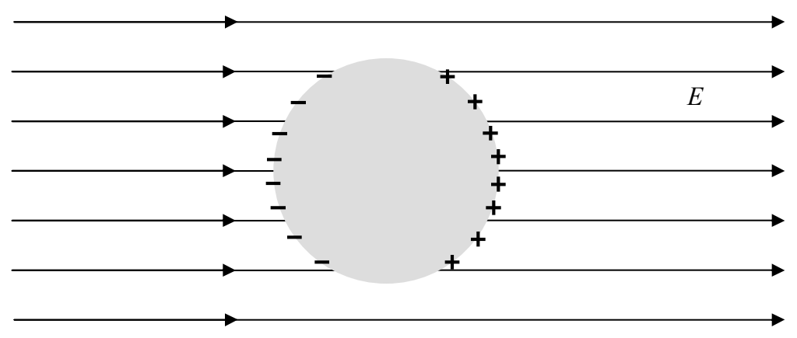
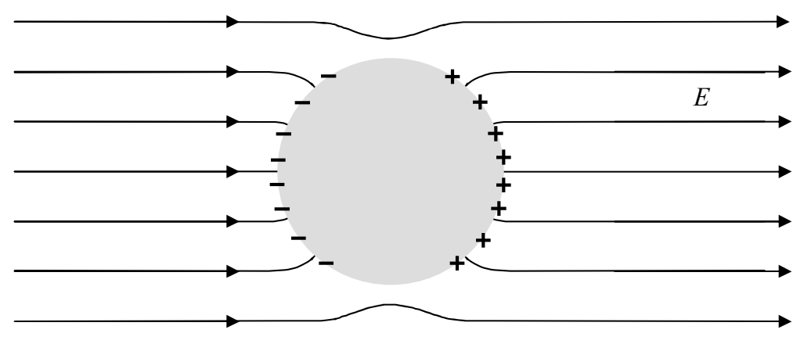

Recall that we were also called upon to describe the electric field at the surface of the conductor. Note that the charge on the surface of the sphere will not only contribute to the electric field inside the conductor, it will also contribute to the electric field outside. The net effect of all the contributions to the electric field in the near vicinity of the sphere is to cause the electric field to be normal to (perpendicular to) the surface of the sphere at all points where it meets the sphere.

How is it that we are able to assert this without doing any calculations? Here's the argument: If the electric field at the surface had a component parallel to the surface, then the charged particles on the surface of the conductor would experience a force directed along the surface. Since those particles are free to move anywhere in the conductor, they would be redistributed. In their new positions, they would make their own contribution to the electric field in the surface and their contribution would cancel the electric field that caused the charge redistribution.

About the charge distribution: The object started out neutral and no charge has left or entered the conductor from the outside world so it is still neutral. But we do see a separation of the two different kinds of charge. Something that we have depicted but not discussed is the assertion that all the charge resides on the surface. (In the picture above, there is positive charge on the right surface of the sphere and an equal amount of negative charge on the left side.) How do we know
