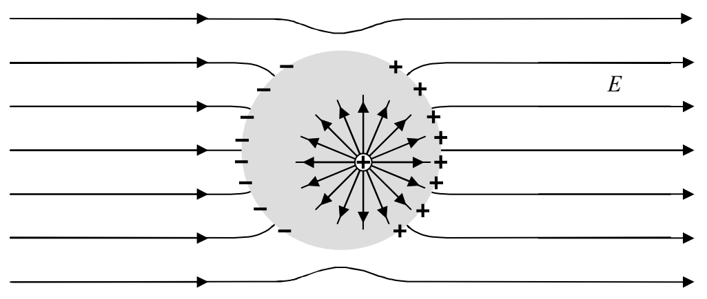
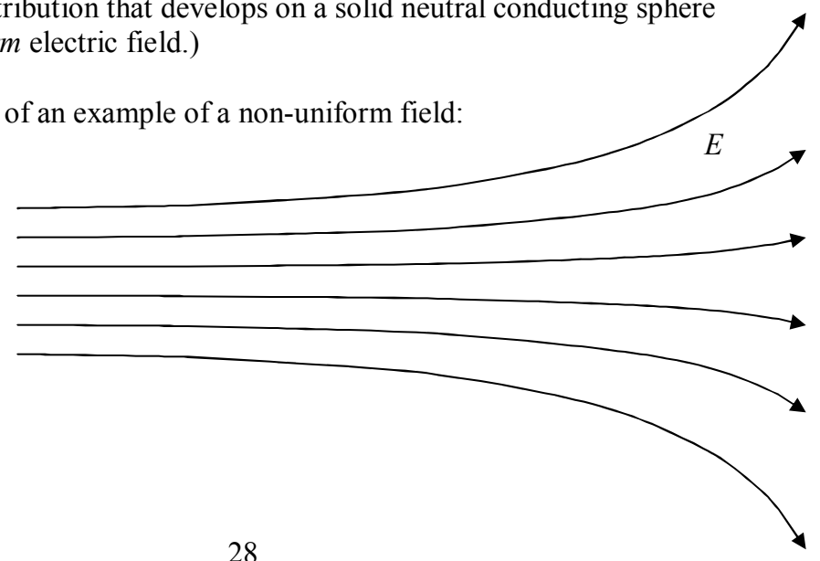

that all charge must be on the surface? Assume that there was a positive point charge at some location within the conductor:

The electric field of that point charge would cause the free-to-move charge in the conductor to move, and it would keep moving as long as there was an electric field. So where would the charge move in order to cancel out the electric field of the positive point charge. You can try any arrangement of charge that you want to, around that positive point charge, but, if it is stipulated that there be a net positive charge at that location, there is no way to cancel out the electric field of that positive charge. So the situation doesn't even occur. If it did happen, the particle would repel the conductor's free-to-move-positive charge away from the stipulated positive charge, so that (excluding the stipulated positive charge under consideration) the conductor would have a net negative charge at that location, an amount of negative charge exactly equal to the originally-stipulated positive charge. Taking the positive charge into account as well, the point, after the redistribution of charge, would be neutral. The point of our argument is that, under static conditions, there can be no net charge inside the material of a perfect conductor. Even if you assume there to be some, it would soon be neutralized by the nearly instantaneous charge redistribution that it would cause.

## Next question:

2) Repeat question 1 for the case of a non-uniform field. (Question 1 asked for a description of the charge distribution that develops on a solid neutral conducting sphere when you place it in a uniform electric field.)

Answer: Here is a depiction of an example of a non-uniform field:

