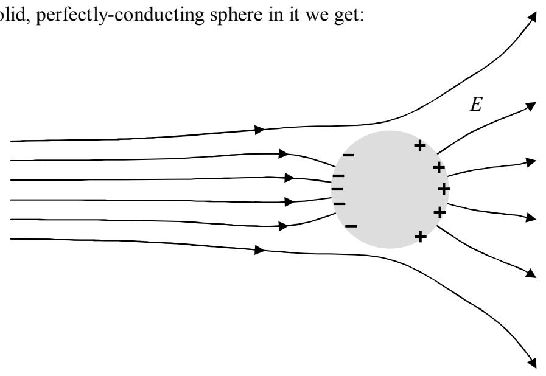

If we put a solid, perfectly-conducting sphere in it we get:

The same arguments lead to the same conclusions. When, after less than a microsecond, the new static conditions are achieved: There can be no electric field inside the conductor or else the free-to-move-charges in it would still be moving around within the volume of the conductor. There can be no unbalanced charge within the volume of the conductor or else there would be an electric field inside the conductor. Hence, any locally unbalanced charge (overall, the initially-neutral sphere remains neutral) must be on the surface. The electric field has to be normal to the surface of the sphere or else the free-to-move-charge at the surface would still be moving around on the surface. The only thing that is different in this case, as compared to the initially-uniform electric field case, is the way the charge is distributed on the surface. We see that the negative charge is more bunched up than the positive charge in the case at hand. In the initially-uniform electric field case, the positive charge distribution was the mirror image of the negative charge distribution.

## Next Question:

3) Suppose you put some charge on an initially-neutral, solid, perfectly-conducting sphere (where the sphere is not in a pre-existing electric field). Describe the electric field inside the conductor, at the surface of the conductor, and outside the conductor as a result of the unbalanced charge. Describe the distribution of the charge in and on the conductor.

Again, we assume that we have waited long enough (less than a microsecond) for static conditions to have been achieved. There can be no charge within the bulk of the conductor or else there would be an electric field in the conductor and there can't be an electric field in the conductor or else the conductor's free-to-move charge would move and static conditions would
