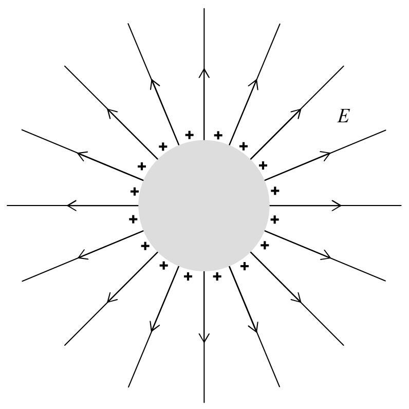

not be prevailing. So, all the unbalanced charge must be on the surface. It can't be bunched up more at any location on the surface than it is at any other location on the surface or else the charge on the edge of the bunch would be repelled by the bunch and it would move, again in violation of our stipulation that we have waited until charge stopped moving. So, the charge must be distributed uniformly over the surface of the sphere. Inside the sphere there is no electric field. Where the outside electric field meets the surface of the sphere, the electric field must be normal to the surface of the sphere. Otherwise, the electric field at the surface would have a vector component parallel to the surface which would cause charge to move along the surface, again in violation of our static conditions stipulations. Now, electric field lines that are perpendicular to the surface of a sphere lie on lines that pass through the center of the sphere. Hence, outside the sphere, the electric field lines form the same pattern as the pattern that would be formed by a point charge at the location of the center of the sphere (with the sphere gone). Furthermore, if you go so far away from the sphere that the sphere “looks like” a point, the electric field will be the same as that due to a point charge at the location of the center of the sphere. Given that outside the sphere, it has the same pattern as the field due to a point charge at the center of the sphere, the only way it can match up with the point charge field at a great distance from the sphere, is if it is identical to the point charge field everywhere that it exists. So, outside the sphere, the electric field is indistinguishable from the electric field due to the same amount of charge that you put on the sphere, all concentrated at the location of the center of the sphere (with the sphere gone).

## Next question:

4) Repeat questions 1-3 for the case of a hollow perfectly-conducting spherical shell (with the interior being vacuum).
